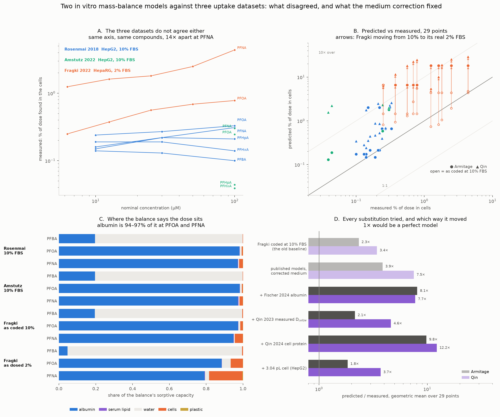

# Qin 2023 vs Armitage 2021 (IV-MBM EQP v2.0) on PFBA, PFHxA, PFHpA, PFOA, PFNA

**This version supersedes the earlier httk-based analysis in this file's
history.** Armitage's Supplementary Section S1, the Fragki main paper and the
Rosenmai supporting information are now in hand, and two of the earlier
conclusions were artefacts of substituting EPA's `httk` for the published
parameterisation. What changed, and why, is in §2.

**Second correction, 2026-10-20 (§15).** Fragki's exposure medium is 2% FBS,
not the 10% of its growth medium. Every number below is on the corrected
value; the pre-correction figures are in this file's history.

Reproduce: `python3 tk_review/scripts/mbm_published_equations.py`,
`python3 tk_review/scripts/mbm_medium_composition.py` and
`python3 tk_review/scripts/make_mbm_figure.py`.
Outputs: `db/mbm_published_equations.csv`, `figures/fig10_mbm_qin_vs_armitage.png`.

## 1. The two equations, as published

**Qin** (confirmed by his own text):

    C_free = C_nom x V_tot / ( V_w
                             + D_BSA/w  x V_protein,medium
                             + D_lip/w  x V_lipid,medium
                             + D_SP/w   x V_protein,cell
                             + D_lip/w  x V_lipid,cell )

`D_SP/w = D_non-specific`: *"D_cell/w was predicted by the MBM (Eq. 17) with
D_non-specific (Table 1) as a surrogate for partitioning to structural proteins
and D_lip/w (Table 2) for lipid."* There is **no cell-water term**: *"we
considered only proteins and lipids of the cell homogenate as the main sorptive
phase for D_cell/w, which is different from Henneberger et al. where the cells
were recognized as an entity containing water, protein and lipid and all of
them contributed."*

**Armitage** Eq. 2, with the SI S1 spLFERs:

    C_W = M_T / ( V_W + D_AW V_A + D_SaW V_Sa + D_SlW V_Sl
                      + D_DsW V_Ds + D_CW V_C + D_PlW A_Pl )

    log K_MW = 1.01 log Kow,N + 0.12
    log K_SaW = 1.08 log Kow,N - 0.70   (log Kow,N < 4.5)
              = 0.37 log Kow,N + 2.56   (log Kow,N >= 4.5)
    d_OW = d_PlW = 3.1,  d_MW = 1.0,  d_SaW = 0.0 for acids   (Table S1)

## 2. What the real SI changed, against the httk stand-in

| | httk `armitage.R` | Armitage 2021 SI | effect |
|---|---|---|---|
| cell composition | one generic cell, membrane lipid **0.04** | **cell-line specific**; the AREc2 line is 0.00046 / **0.00414** / 0.0514 / 0.944 (Table S5). AREc2 is AREc32, which is **MCF7-derived**, not hepatic — see §17 | **9.1×** |
| albumin spLFER | `0.71 logKow + 0.42` | piecewise `1.08 logKow − 0.70` / `0.37 logKow + 2.56` | 1.6× |
| ionisation offsets | d_OW = d_PlW = 3.5 | **3.1** | small |
| anionic phospholipids, lysosomes | present | absent from the published model | small |

The cell-composition term dominates, because Armitage's PFAS cell is almost
entirely membrane lipid and the hepatic line has ten times less of it than the
generic default. On Rosenmai PFOA at 100 µM: published 0.660% of dose in cells,
with httk's generic cell 6.007%, measured 0.330%.

Two independent checks that the composition table is the right one to use:
Armitage's PPARγ line (HEK293H — Qin's own cell line) is listed at **0.08**
protein by volume against Qin's measured **0.0814**; and Armitage's AREc2 at
10 ng/cell × 5.14% protein × 1.35 g/mL gives **694 pg protein per cell**
against the project spreadsheet's **675 pg/cell**.

## 3. Why the two models behave differently

**They put the PFAS in different places, and nearly agree by coincidence.**
At a common C_w = 1 µM:

| | nCF | Qin D_cell/w | Armitage D_cell/w | ratio | Qin D_BSA/w | Armitage D_SaW | ratio |
|---|---|---|---|---|---|---|---|
| PFBA | 3 | 2.4 | 1.2 | 1.99 | 520 | 138 | 3.76 |
| PFHxA | 5 | 25.4 | 10.1 | 2.52 | 4 952 | 6 503 | 0.76 |
| PFHpA | 6 | 83.2 | 56.4 | 1.47 | 12 044 | 26 501 | 0.45 |
| PFOA | 7 | 272 | 337 | 0.81 | 24 298 | 51 615 | 0.47 |
| PFNA | 8 | 892 | 2 036 | 0.44 | 45 849 | 100 531 | 0.46 |

The two cell ratios land within 0.44–2.5× of each other — but for unrelated
reasons:

- **Qin's cell is 92–95% protein** (the measured D_non-specific) and 5–8%
  lipid, with no water at all.
- **Armitage's cell is 79% water at PFBA**, flipping to **99.7% membrane
  lipid** by PFNA. Its bulk-protein term contributes 0.1–0.2%, because protein
  is treated as 3.5% of octanol and the anion then takes the −3.1 penalty.

So the one phase Qin says carries nearly all the PFAS is the one phase
Armitage's cell effectively ignores. The numerical agreement across these five
compounds is a coincidence of two wrong-looking routes crossing.

**The real divergence is now in albumin, not the cell.** Armitage's piecewise
spLFER rises 1.08 per log Kow below 4.5 — 0.83 per CF2 — then flattens to 0.285
per CF2 above it. Qin's measured affinity rises smoothly at ~0.49 per CF2. The
kink falls between PFBA and PFHxA, so Armitage reads 3.8× *low* at PFBA and
2.1–2.2× *high* from PFHpA up. Since albumin holds 19–98% of the dose in these
assays, that is what moves the predictions.

## 4. Dose dependence: the one test Armitage cannot pass

Fitting C_cell ∝ C_nom^b:

| series | measured | Qin | Armitage |
|---|---|---|---|
| Rosenmai PFBA | 0.85 | 1.15 | 1.00 |
| Rosenmai PFHxA | 0.87 | 1.58 | 1.00 |
| Rosenmai PFOA | 1.14 | 1.82 | 1.00 |
| Rosenmai PFNA | 1.31 | 1.81 | 1.00 |
| Fragki PFOA | 1.42 | 1.49 | 1.00 |
| Fragki PFNA | 1.42 | 1.62 | 1.00 |

Armitage is linear by construction and is pinned at exactly 1.00. The measured
exponent rises monotonically with chain length, 0.85 → 1.42, and Qin reproduces
that ordering, overshooting by 0.30–0.71 on Rosenmai and by only 0.07–0.20 on
Fragki. This is the only place where Qin's extra machinery buys something
Armitage structurally cannot deliver.

It is also the one thing the §15 medium correction *improves*: on 2% FBS
Qin's Fragki exponents fall from 1.71 and 1.66 to 1.49 and 1.62 against a
measured 1.42. Less albumin means less of Qin's Langmuir saturation, and the
curvature it was adding was partly an artefact of a sink five times too big.

The two models' error still swaps sign with dose, though the correction has
moved Qin's low-dose advantage onto Armitage:

| | ≤25 µM | >25 µM |
|---|---|---|
| Armitage | 6.08× | **2.94×** |
| Qin | 5.99× | 8.63× |

## 5. Performance

Fraction of dose in cells, n = 29:

| | Armitage / measured | Qin / measured |
|---|---|---|
| PFBA | 1.2–1.7× | 1.8–3.4× |
| PFHxA | 0.8–3.3× | 2.5–40.5× |
| PFHpA | 1.0–4.3× | 2.8–50.5× |
| PFOA | 2.0–26.3× | 1.7–32.9× |
| PFNA | 4.2–14.6× | 2.4–10.6× |
| **overall bias** | **3.87×** | 7.52× |
| **overall \|error\|** | **4.02×** | 7.52× |

Implemented from its own SI, Armitage is the better predictor overall and is
remarkably good on Rosenmai's short chains (0.8–1.7×). Both models now
over-predict everywhere; what used to look like a low-dose regime where Qin
won was Fragki's dose series being run on five times too much albumin (§15).

The error is no longer spread evenly across compounds. PFBA–PFHpA, which only
Rosenmai and Amstutz measure, are unchanged at 1.2–1.6× for Armitage. PFOA and
PFNA, the two compounds Fragki contributes, carry almost the whole residual.

Qin's parameters are measured only for PFBA and PFOA; PFHxA and PFHpA are
interpolated between those two carboxylate anchors and PFNA is extrapolated
beyond both (open symbols in the figure). Its two worst compounds, PFHxA and
PFHpA, are interpolated ones.

## 6. Why Rosenmai stands out: the axis label, not the measurement

Rosenmai's Abstract says **"4–2500 ng mg⁻¹ protein"**; Results §3.3 and the
Fig. 2A axis say **nmol mg⁻¹ protein**. The full Results sentence settles that
these are the same numbers:

> "The cellular PFAS concentrations, expressed as nmol mg⁻¹ protein, for the 14
> PFASs at treatment concentrations of 10, 30 and 100 μM are shown in Figure
> 2(A). The concentrations ranged 18–2490 nmol mg⁻¹ protein for the PFCAs,
> 4–494 nmol mg⁻¹ protein for the PFSAs, and were 81 and 435 nmol mg⁻¹ protein
> for FOSA."

The union of those three sub-ranges is **4 to 2490** — minimum 4 from the
PFSAs, maximum 2490 from the PFCAs. The Abstract's range is **4 to 2500**.
Same minimum, same maximum to rounding. One set of numbers is being reported
under two different units, so **exactly one label is a typo and no reading
makes both correct**. (The Abstract is therefore not an independent vote for
ng/mg — it is the same data. Which label is wrong has to be settled on
physical grounds.)

Four checks say the numbers are ng/mg.

**(a) Rosenmai against Amstutz.** Same cell line, same dose, same stated unit:

| at 100 µM | Rosenmai | Amstutz | ratio | Rosenmai ÷ MW | ratio |
|---|---|---|---|---|---|
| PFHxA | 164 | 0.289 | 568× | 0.522 | 1.81× |
| PFHpA | 297 | 0.326 | 911× | 0.816 | 2.50× |
| PFOA | 525 | 1.815 | 289× | 1.268 | 0.70× |
| PFNA | 458 | 2.237 | 205× | 0.987 | 0.44× |

**(b) Rosenmai against itself.** Its uptake-% table and its Fig. 2A values are
the same measurement normalised differently, so the medium volume reconciling
them must be one number for all 15 rows. Read as ng/mg it is 1.03–2.20 mL for
the three pooled wells; read as nmol/mg it is 423–645 mL. A Corning 12-well is
22.1 mm across and ~17.5 mm deep, so one well brim-full is 6.7 mL and the whole
plate is 81 mL: the ng/mg reading needs 5–11% of three wells, the nmol/mg
reading needs **5–8× the entire plate**. It is the absolute magnitude that
discriminates, and it does so without anyone knowing the true working volume.

*A check that does NOT work, recorded so it is not repeated.* The implied
volume is constant within each compound across doses (PFOA 1.39 / 1.41 /
1.44 mL over a 10× range). An earlier version of this section called that
tightness decisive. It is not evidence at all: the two readings differ by a
constant molecular weight per compound, so they scale identically with dose and
the dose consistency is the same under either. Nor can reading one value off
the figure settle it — PFOA at 100 µM reads 525, which under ng/mg implies
0.47 mL/well and under nmol/mg implies 195 mL/well; without an independently
known working volume that observation only re-derives the volume, it does not
test the unit.

*A residual that survives the fix.* Between compounds the implied volume runs
2.14× (PFBA 2.11 mL down to PFNA 1.15 mL), decreasing monotonically with chain
length. Rosenmai's Table S2 internal-standard recoveries of 78–98% span only
1.26×, so something else is also going on in that paper.

**(c) Scale, by sub-class.** Back-calculating every compound in Rosenmai's
Table 1 at the PFOA-implied volume gives PFCAs 12–1510 ng/mg and PFSAs
8–96 ng/mg, against the stated 18–2490 and 4–494. The same scale. Read as
nmol/mg the stated minima are 330× (PFCA) and 520× (PFSA) above what the
uptake table supports. The PFSA minimum of 4 is the sharpest of these, because
PFOS has the lowest uptake of any compound in Table 1 (0.04–0.05%) and so pins
the bottom of the range.

The FOSA entry corroborates that these are the Fig. 2A numbers: it has only
*two* values, 81 and 435, because 100 µM was dropped for FOSA on cytotoxicity
grounds — so Fig. 2A carries two FOSA bars, not three.

**(d) Physical ceiling.** As nmol/mg, Fig. 2A puts PFOA at 253 mM and PFNA at
266 mM inside the cell — a quarter of the cell by mass.

**(e) A second label error in the same paper.** The supporting information's
Figure S2 gives total protein per well in **ng/cm²**, with bars at a few
hundred. A 12-well is 3.5 cm², so that reads as a few micrograms of protein per
well, about 40× too little for 1.8 × 10⁵ HepG2 cells; as µg/cm² it is ~20× too
much. Whichever way it is read it cannot be right as printed, which establishes
that unit labels in this paper are not reliable.

Reading the axis as nmol/mg multiplies C_cell by exactly the molecular weight,
**214× (PFBA) to 464× (PFNA)** — 2.33–2.67 decades — and because the factor
tracks MW it also tilts the chain-length trend by 0.34 decades.

On a fraction-of-dose basis Rosenmai does not stand out at all. The measurement
is sound; the conversion to concentration is where the outlier is created.

## 7. Which axis to plot

Every source agrees on **protein per cell** — Armitage's AREc2 gives 694
pg/cell, the project spreadsheet 675 pg/cell — and disagrees **3.3× on cell
volume** (10 pL vs 3.04 pL). Since all three datasets report per mg protein,
the *fraction of dose in cells* is insensitive to that disagreement while
*C_cell* carries all of it. Model discrimination should be done on the fraction.

## 8. Geometry, now sourced rather than assumed

| | plate | medium | cells | FBS |
|---|---|---|---|---|
| Rosenmai | 12-well × 3 pooled | 3 × 1 mL (assumed; §6b implies ~0.7 mL/well) | 5.43 × 10⁵ | 10% |
| Amstutz | 96-well | 250 µL | 4 × 10⁴ | 10% (verified) |
| Fragki | 24-well | **550 µL** (stated) | seeded 55 000/well, differentiated | **2%** (verified, §15) |

Fragki's main paper confirms the plate and volume I had assumed. The FBS it
does not confirm: exposure was in "assay medium (growth medium containing 2%
FBS)", not the 10% growth medium — see §15. The cell count at exposure is still
not stated for differentiated HepaRG; 2.2 × 10⁵ is used. Because Fragki reports
nmol/mg protein, the measured fraction and the predicted fraction both scale
with cell number and the ratio is insensitive to it — over a 4× change in N the
Armitage ratio moves only 8.69× → 7.89×.

**That cancellation is specific to Fragki and does not extend to Rosenmai**,
whose Table 1 is already an uptake *percentage*: the measured value is fixed,
only the prediction scales, and the ratio moves 1.00× → 3.97× over the same 4×
change in N. Rosenmai's 5.43 × 10⁵ is three wells at the *seeded* 1.8 × 10⁵,
and HepG2 divide between seeding and exposure (medium changed at 48 h, dosed at
72 h), so the true count is plausibly higher and the comparison would move with
it. `MBM_PRIMER.md` §5 works this through, along with the related point that
choosing the fraction-of-dose axis buys comparability between studies but **no**
immunity to the cell-volume uncertainty: predicted ÷ measured is identical on
the concentration and fraction axes.

## 9. Remaining caveats

- Fragki's 6.25 µM values in the project sheet (PFOA 0.0562, PFNA 0.281) still
  disagree with supplementary Table 2 (0.09226, 0.22203); the 25 and 100 µM
  values match to 1–3%. On the supplementary values Fragki PFOA gives b = 1.23
  rather than 1.42, so the direction is robust.
- Armitage 2021 did run PFOS through IV-MBM EQP v2.0 (workbook sheets AEID767,
  AEID1325), which would make a direct validation target, but the sheets' two-
  row headers defeat clean extraction and the PFAS rows could not be read
  reliably. Not pursued.
- ~~Rosenmai's exposure FBS is unverified at source.~~ **Resolved 2026-10-20**:
  the paper is now in hand and §2.2 gives DMEM + 10% FBS with no serum
  reduction at exposure, so the coded value is right. What it also gives is a
  **3% ethanol** co-solvent (§2.1, §2.4) — see §15.
- ~~AREc2's water content of 0.944 is high for a cell and its protein of
  0.0514 low; it is used because it is the composition Armitage's own model was
  run with for a HepG2-derived line, not because it is independently
  plausible.~~ **Half resolved, half wrong, 2026-10-22** (§17): the suspicion
  about the numbers was right — Fischer et al. 2017 measured HepG2 at 87.35%
  water, 9.46% protein, 3.19% lipid — but the justification was wrong. AREc2 is
  AREc32, an **MCF7-derived** line (Cellosaurus CVCL_1D32), so it is not a
  hepatic composition at all and was never the closest published match.

## 10. The fraction-of-dose axis, and the project spreadsheet on it

Figure 10 is now built on fraction of dose in cells (§7). Converting the
spreadsheet's nmol/mg columns with the agreed 675 pg protein per cell:

| over 29 points | bias | \|error\| |
|---|---|---|
| project sheet Armitage | **0.90×** | 2.86× |
| published-equation Armitage | 3.87× | **4.02×** |
| published-equation Qin | 7.52× | 7.52× |
| project sheet Qin | **57×** | 57× |

The sheet's Armitage is essentially unbiased and runs 0.39× of the
published-equation version on average — the two bracket the data.

The sheet's Qin is a different matter. Its bias and its absolute error are
equal to four figures, so every point is high by nearly the same factor: a
scale error, not scatter. On the fraction axis the failure is obvious —
it places **6–82% of the dose inside cells that occupy 0.18% of the well
volume**, where Rosenmai and Amstutz both measure 0.04–0.33%. Two candidates,
in order of size:

1. **D_cell/w used as a lumped ratio** rather than composed as
   `D_SP/w × V_protein,cell + D_lip/w × V_lipid,cell`. For PFBA the lumped
   route gives 31 per litre of whole cell against the composed route's 2.4 —
   13×.
2. **Dividing by C_nominal rather than C_free.** Qin's ratios are defined
   against the freely dissolved concentration. Small for PFBA (~1.25×) but
   large by PFOA, where albumin holds 89% of the dose.

Neither is visible in the sheet's output columns, so these are checks to run
rather than a decomposition.

### Rosenmai on the fraction axis

This is the cleanest form of the unit problem, because the axis is unit-free
and the comparison is internal to one paper. At 100 µM:

| | Table 1 uptake | Fig 2A as ng/mg | Fig 2A as nmol/mg |
|---|---|---|---|
| PFBA | 0.100% | 0.072% | 15.4% |
| PFHxA | 0.140% | 0.064% | 20.1% |
| PFHpA | 0.210% | 0.100% | 36.3% |
| PFOA | 0.330% | 0.155% | 64.2% |
| PFNA | 0.310% | 0.121% | 56.0% |

Across all 15 rows the nmol/mg reading contradicts Rosenmai's own uptake table
by **141–215×**, and would put 15–64% of the dose inside 0.18% of the well
volume. The ng/mg reading sits within 1.4–2.1× of the uptake table, the
residual being the unstated working volume (§6b implies ~0.7 mL/well against
the 1 mL assumed).

## 11. The wash artefact hypothesis: refuted on three counts

Earlier sections floated five ice-cold PBS/DPBS washes as a chain-length-
dependent loss that would bias measured C_cell low. It does not survive.

**(a) It is not a between-study variable.** All three studies wash five times:
Rosenmai "washed 5 times with ice-cold phosphate-buffered saline", Amstutz
"washed... with DPBS" following Rosenmai's protocol, and Fragki "Cells were
washed 5 times with Dulbecco's Phosphate Buffered Saline". A shared protocol
cannot explain differences between them.

**(b) The direction is backwards.** Washing should strip the shortest, least
bound, fastest-desorbing chains hardest, so the models should over-predict
*short* chains most. They do the opposite — Armitage's over-prediction rises
monotonically with chain length:

| | nCF | Armitage/measured | Qin/measured |
|---|---|---|---|
| PFBA | 3 | 1.42× | 2.36× |
| PFHxA | 5 | 1.20× | 8.78× |
| PFHpA | 6 | 1.55× | 9.03× |
| PFOA | 7 | 6.21× | 12.71× |
| PFNA | 8 | 8.54× | 5.62× |

Armitage: **+0.172 decades per CF2, r = +0.83**. Qin now shows the same trend
(+0.092, r = +0.63); before the §15 correction it showed none. Washing would
strip short chains hardest, so both trends point away from the hypothesis.

**(c) The magnitude is two orders out.** Fragki's time course puts steady state
at ~1 h, so the cell↔medium exchange half-time is ~10–30 min. Five quick rinses
give 1–2 min of contact:

| exchange t½ | 1 min contact | 2 min | 5 min |
|---|---|---|---|
| 10 min | 6.7% lost | 12.9% | 29.3% |
| 20 min | 3.4% | 6.7% | 15.9% |
| 30 min | 2.3% | 4.5% | 10.9% |

A 3–5× loss needs 1.5–2.3 exchange half-lives of contact — 15–45 minutes of
washing. The hypothesis is dead at the order-of-magnitude level.

The one thing it was invoked to explain, Amstutz reading 3.6–4.8× below
Rosenmai for PFHxA and PFHpA while agreeing to 1.0–1.4× for PFOA and PFNA, is
better explained by short-chain analytical recovery: Rosenmai's own Table S2
reports internal-standard recoveries of 78–98% that vary by compound.

---

## 12. Testing the albumin parameter against the best measurement

Added 2026-10-16. Reproduce with
`python3 tk_review/scripts/mbm_fischer_albumin.py`; full detail in
`report/REPORT.md` §6.1b–6.1c.

Section 4 of this memo found the divergence between the two models to be in
albumin, not in the cell. That raised an obvious question: can either model be
improved by giving it a *measured* albumin partition coefficient instead of
its own? Fischer 2024 is the only albumin dataset taken at a ligand:protein
ratio below 0.004, so it is the natural reference. The assays run on fetal
bovine serum, so its BSA column applies.

Converting a binding constant into a partition coefficient is exact in the
trace limit — `D = 1000·n·Ka / M_alb`, so `log D = log Ka + log n − 1.823`
(mass basis) or `− 1.688` (the volume basis both models use). Qin's own
albumin term is this expression: identifying `Cmax = n × 20,527 µM` reproduces
Qin's two Cmax columns to 0.3% on all four of their measured compounds.

**Result: the substitution makes both models worse.**

| variant | bias | \|err\| | ≤25 µM | 100 µM | dose swing |
|---|---|---|---|---|---|
| Qin, published | 7.52× | 7.52× | 5.99× | 8.63× | 1.44× |
| Qin + Fischer, constant D | 7.75× | 7.75× | 10.39× | 6.47× | **0.62×** |
| Qin + Fischer, rescaled Langmuir | 15.71× | 15.71× | 17.59× | 14.66× | 0.83× |
| Armitage, published | **3.87×** | **4.02×** | 6.08× | 2.94× | 0.48× |
| Armitage + Fischer | 8.08× | 8.08× | 12.01× | 6.34× | 0.53× |

Fischer's value is below both models' for every compound (0.14–0.61× of Qin,
0.17–0.61× of Armitage), so substituting it shrinks the albumin sink and
pushes more dose into the cell — and both models already over-predict.

**Two findings survive the negative result.**

*Qin's dose dependence is an albumin-saturation artefact.* Its published error
swings 3.49× across the dose range; with a constant albumin coefficient the
swing is 0.99×. The dose exponent Qin produces (1.15–1.82 against a measured
0.85–1.42, section 4 of this memo) therefore says nothing about PFAS uptake —
it is the Langmuir term coming off saturation.

*Albumin cannot carry the level error.* Inverting the balance for the D_alb
that would make each model unbiased gives values **above** each model's
current one, while the measurement sits **below** it. For PFHxA the needed
value exceeds anything ever measured for that compound by 8.6–13.2×, even
allowing six binding sites. So albumin is where the sensitivity is (it holds
19–94% of sorptive capacity) but not where the error is, and the remaining
candidates are the cell term, the plastic term, and the measured C_cell values.

---

## 13. The cell term: slope exonerated, level convicted

Added 2026-10-19. Reproduce with `python3 tk_review/scripts/mbm_cell_term.py`;
full detail in `report/REPORT.md` §6.1d.

Section 12 ruled albumin out as the source of the over-prediction. The cell
term is the other large compartment, and it is where the two models disagree
most about mechanism while agreeing most about value.

**Composition.** Armitage's cell is 79% water at PFBA and 99.7% membrane lipid
at PFNA, with protein contributing 0.1–0.2% throughout (only 3.5% of protein
is sorptive, and that fraction is treated as octanol). Qin's cell is 92–95%
protein at every chain length, with no water phase. They differ on the cell
partition by 0.44–9.5×, yet their predicted fraction of dose in the cell
agrees to 0.6–2.5×, because the albumin term damps the difference. Agreement
on the output is not corroboration of the mechanism.

**The slope.** Against Qin's own Table 2 both models look 2.9–4.4× too steep in
chain length. That reading is wrong. Inverting the balance for the cell
partition the uptake data require gives **+0.407** decades per CF₂ on the
corrected media; the models give +0.515 and +0.782; Ryu 2024's whole-tissue
f_unbound gives 0.46–0.53. Qin's Table 2 alone gives +0.177, and at PFBA it is
20× above what the uptake requires. Three independent lines against one:
Qin's slope is fine. **Armitage's is not** — it sits 0.38 above the uptake
requirement, and §16 shows that is where the residual chain-length dependence
comes from.

Substituting Qin's measured D_cell/w confirms it. Mean bias improves (Qin
7.52 → 4.61, Armitage 3.87 → 2.15) and so does absolute error (7.52 → 5.43,
4.02 → 2.91) — but look at where it goes: PFBA is over-predicted **19.7× and
23.6×** while PFNA lands at 1.14× and 0.73×. The aggregate improves because a
wild over-prediction at one end is being averaged against a good fit at the
other. Centring the fit while destroying the trend is what substituting an
outlier looks like.

**The level.** Qin's cell partition runs 1.5–9.2× above the uptake requirement
and Armitage's 0.25–6.2×, both worst mid-series at PFHxA–PFHpA. Those factors
are conditional: redoing the inversion under Qin's, Armitage's and Fischer's
albumin moves the implied level 2.6–8.3×, though the slope survives all three
(+0.72 to +0.82). Read the level as "several-fold too high, worst mid-chain".

**What to fix.** Not the lipid or octanol descriptor — the chain-length
dependence is already right. The two remaining candidates are the sorptive
capacity assigned to cell protein (Qin's measured D_non-specific versus
Armitage's "3.5% of protein behaves as octanol" — wildly different guesses at
the same quantity, and the substance of each model's cell term) and the cell
volume the result is normalised by, which is uncertain to 3.1× across the
three compositions in play.

---

## 14. Candidate 1 eliminated; the cell volume is what is left

Added 2026-10-19. Reproduce with `python3 tk_review/scripts/mbm_cell_protein.py`;
detail in `report/REPORT.md` §6.1e. This closes the mass-balance line.

Two papers made the test possible. **Qin et al. 2024** (ES&T 58:9954, the same
group as the 2023 model) measured specific and nonspecific protein–water
distribution ratios for 16 PFAS by SPME over four orders of magnitude.
**Chen et al. 2025** (ES&T 59:82) independently writes the Kd → partition
coefficient bridge of §6.1b as its Equation 4.

**Candidate 1 was cell protein.** Qin's 2023 interpolation turns out to sit
within 1.1–2.5× of his own later measurement with the same slope, so the model
was not damaged by interpolating three of the five compounds. Armitage's
octanol surrogate is another matter: 0.035·D_ow runs **457–7,820× below** the
measured protein affinity and 1.5× too steep. That is why Armitage's cell is
~100% membrane lipid — the convention has defined its protein term out of
existence.

> **Provenance, settled 2026-10-21.** The SI is now in hand
> (`literature/fulltext/Armitage 2021 Toxics IV-MBM EQP v2.0 SUPPLEMENTARY.pdf`,
> from the Europe PMC supplementary package — MDPI blocks direct download).
>
> It confirms **everything else** this implementation uses, verbatim: both
> spLFERs (S1.3, `1.01·logKow + 0.12` and the piecewise albumin form), all four
> scaling factors (Table S1: d_OW 3.1, d_MW 1.0, **d_SaW 0.0** for acids,
> d_PlW 3.1), and the AREc2 and PPARγ cell compositions (Table S5: 10 ng/cell,
> 0.00046 / 0.00414 / **0.0514** / 0.944). Table S5 also confirms §6.1b's
> remark that Armitage's own evaluation mixes serum levels — AREc2 at 10% FBS,
> PPARγ at 2.0%.
>
> **What it does not contain is any statement of how bulk protein sorbs.** No
> 0.035, no octanol-equivalence, no `K_cell/w` equation. Section S1 covers
> anionic phospholipids, lysosomal sequestration and the spLFERs, then defers
> to Armitage 2014 for temperature and salinity adjustments *only*. Nor can the
> 2014 SI hold it: the v2.0 main text lists bulk protein among the things v2.0
> **added** ("proximate composition of cells expanded to include storage
> lipids, membrane lipids, bulk proteins and water").
>
> **So the cell-protein term is new in v2.0 and undocumented in the published
> record** — it lives only in the Excel/VBA tool, available by request. The
> 0.035 here is `httk`'s. Accordingly this section and §16 should be read as
> findings about **`httk`'s implementation** of IV-MBM EQP v2.0; whether they
> also indict Armitage's own tool cannot be decided from the papers, and would
> need the tool itself. The *structural* point is unaffected either way: a cell
> whose protein term is negligible is a cell made of lipid, and a lipid cell
> carries too steep a chain-length slope.

But substituting the measured value makes both models **worse** (Qin 7.52 →
12.24, Armitage 3.87 → 9.81), because the measurement is *higher* than either
model assumes and both already over-predict.

**The pattern across all three substitutions:**

| parameter | best measurement | direction | effect |
|---|---|---|---|
| albumin (Fischer 2024) | below both models | smaller competing sink | worse |
| cell D_cell/w (Qin 2023 T2) | mixed | — | centres, disperses |
| cell protein (Qin 2024) | above both models | bigger cell sink | worse |

All three move dose into the cell. No partition coefficient fixes an
over-prediction here, because the measured values do not point that way.

**The cell volume halves it, and no longer closes it.** Rerunning the published
models at 3.04 pL/cell instead of 10 ng/cell (AREc2) gives Qin 7.52 → 3.71×
and Armitage 3.87 → 1.84×. It is still the one knob that rescales every
compound by the same factor, which is what a level offset independent of chain
length requires — and the assays modelled are HepG2 and HepaRG, not AREc2.
**But see §17: that 3.04 pL is Fischer et al. 2017's measurement, and Fischer
measured the composition of the same cells in the same table. Taking the
volume while keeping Armitage's composition uses half of one measurement;
taking it whole gives 9.10×, not 1.84×.** But before §15 this substitution reached 1.60× and 1.08×,
i.e. it looked like the whole answer. On the corrected medium it accounts for
about half the residual in log terms and leaves a 1.8–3.7× over-prediction
standing. None of the three uptake papers reports its cell volume, so that part
stops here; what §15 adds is that the cell volume now has to share the blame.

**One result worth keeping regardless.** Qin 2024 reports both binding regimes
for the same protein and compound: specific exceeds nonspecific by 3.0–5.0×
across PFBA–PFOA, with specific dominating below ν ≈ 0.01 and nonspecific
above ν ≈ 1. That is the direct measurement of the ligand:protein regime
effect §6.1a inferred, and it quantifies the penalty for carrying an in vitro
constant into a physiological calculation without asking which regime produced
it.

---

## 15. The exposure medium is not the growth medium

Added 2026-10-20. Reproduce with `python3 tk_review/scripts/mbm_medium_composition.py`;
output `db/mbm_medium_composition.csv`.

All three assays were coded at 10% FBS, read off each paper's **culture**
section. Two of the three state something different for the medium the cells
were actually **dosed** in.

| | growth medium | exposure medium | DMSO carrier | verified |
|---|---|---|---|---|
| Rosenmai 2018 | DMEM + 10% FBS | *the culture medium*, 10% FBS | **3% ethanol** | yes |
| Amstutz 2022 | DMEM + 10% FBS | *the culture medium*, 10% FBS | 0.1% DMSO | yes |
| Fragki 2022 | William's E + 10% FBS | **assay medium: growth medium + 2% FBS** | 0.5% DMSO | yes |

Fragki et al. 2022, §2.2–2.3, verbatim:

> "Prior to biokinetic studies, differentiated HepaRG cells were incubated for
> 24 h in assay medium (growth medium containing **2% FBS**) supplemented with
> 0.5% DMSO… Test chemicals were diluted from 200-fold concentrated stock
> solutions **in assay medium**, providing exposure medium with a final DMSO
> concentration of 0.5%."

Amstutz et al. 2022, §2.3, verbatim: PFAS were "added from stocks in DMSO **to
the culture medium**", the DMEM + 10% FBS of §2.2.

**Why it matters more than it looks.** Serum fraction multiplies the two
largest sinks in the denominator:

```
V_albumin     = V_medium · f_FBS · 0.733 mL/g · 42 g/L
V_serum_lipid = V_medium · f_FBS · 1.03 g/L
```

and in Fragki's well albumin carries **97% of the denominator for PFOA** at
10% FBS. Cutting the serum five-fold shrinks the sorptive capacity ~4×, which
raises the free concentration ~4×, which raises every predicted uptake ~4×.

| Fragki, bias | at 10% FBS (as coded) | at 2% FBS (as dosed) |
|---|---|---|
| Qin | 1.54× | **14.92×** |
| Armitage | 2.48× | **10.80×** |

**The dataset that looked like the models' best case was the one being handed
five times more albumin than it had.** Overall: Qin 3.43 → 7.52×, Armitage
2.33 → 3.87×.

Armitage moves by 4.4×, which is the denominator argument almost exactly,
because its albumin term is linear. Qin moves by 9.7× — *more* than the
denominator shrinks — because its albumin is a saturating Langmuir: a higher
free concentration drives D_BSA/w down, which shrinks the denominator again.
**A model with a saturating sink amplifies an error in the size of that sink.**
That is a general property worth carrying forward, not a quirk of this dataset.

### The co-solvents: real, 30-fold apart, and almost worthless

The three assays dose from three different vehicles, and the spread is larger
than the FBS spread looks:

| | co-solvent | σ | log shift | as a factor |
|---|---|---|---|---|
| Rosenmai | **3% ethanol** | 4.5 | **0.135** | **1.36×** |
| Fragki | 0.5% DMSO | 4.0 | 0.020 | 1.05× |
| Amstutz | 0.1% DMSO | 4.0 | 0.004 | 1.01× |
| *the serum difference* | — | — | *0.70* | *5.00×* |

Log-linear cosolvency shifts log K by σ·f_cosolvent; σ ≈ 1.5–4 per unit volume
fraction for a hydrophobic solute in aqueous DMSO and a little more in ethanol,
and the aggressive end is used throughout so the estimate cannot flatter the
conclusion. Rosenmai's ethanol is **7× Fragki's DMSO shift and 34× Amstutz's**.
So the co-solvent *is* a between-study variable — just not the one the 2% vs
10% looked like, and still 5× smaller than the serum.

**And it cancels.** A co-solvent lowers *every* water-to-phase partition
coefficient by the same factor k, and the quantity being predicted is a ratio
of sorptive terms:

```
x_cell = D_cell·V_cell / (V_w + D_alb·V_alb + D_lip·V_lip + D_cell·V_cell)
```

Divide every D by k and k cancels top and bottom — except against **V_w**, the
one term with no D on it. So the co-solvent only bites where water carries a
real share of the denominator. Dividing all of Rosenmai's D by 1.35:

| | Armitage bias | PFBA | PFHxA | PFOA | PFNA |
|---|---|---|---|---|---|
| as published | 1.97× | 1.42× | 0.86× | 2.38× | 9.33× |
| ÷1.35 (3% ethanol) | 1.86× | **1.11×** | 0.83× | 2.37× | **9.31×** |

PFBA moves (water is 80% of its denominator); PFNA does not move at all (water
is 0.5% of its denominator). **The general lesson is worth more than the
number: an error that multiplies every sorptive term cancels on this axis, and
only an error in the *relative* size of two sinks survives.** That is exactly
why the FBS fraction is devastating and the vehicle is not.

One DMSO point is *not* about partitioning. HepaRG are differentiated in 1.7%
DMSO for twelve days and held there — that is what makes them hepatocyte-like,
and it also loads them with triglyceride, which the companion paper (Louisse
et al. 2023) measures as an endpoint. Both models run Fragki on the **AREc2**
composition, with membrane lipid 0.00414, because that is the composition
Armitage's SI publishes for its own reporter-line simulations. It is not a
liver-line composition: AREc2 is AREc32, which is MCF7-derived (§17). A
differentiated, DMSO-matured HepaRG is a different cell again. That error is in the
cell term, which §13–14 already name as where the residual lives — so the two
errors are independent and stack.

### Does the measured data show the serum effect?

If 2% FBS leaves five times less albumin competing with the cells, Fragki's
*measured* uptake should sit above the 10% FBS studies at the same nominal
dose. It does:

| | dose | Rosenmai 10% | Amstutz 10% | Fragki 2% | ratio |
|---|---|---|---|---|---|
| PFOA | 100 µM | 0.330% | 0.245% | 0.780% | 2.7× |
| PFNA | 100 µM | 0.310% | 0.302% | 4.385% | 14.3× |

The direction is right and the PFOA magnitude is close to the predicted ~4×.
It is corroboration, not proof: the cell line differs too, and differentiated
HepaRG are larger and more lipid-rich than HepG2. PFNA at 100 µM is also the
one point Fragki themselves set aside from their QIVIVE, for low protein
content suggesting cytotoxicity; it is retained in the model comparison here
and it is the largest measured value in the set.

### What this changes

1. **§5 performance.** Both models over-predict everywhere. PFBA–PFHpA, which
   only the 10% FBS studies measure, are untouched (Armitage 1.2–1.6×). PFOA
   and PFNA carry almost the whole residual.
2. **§4 dose exponent** *improves* for Qin on Fragki, 1.71 → 1.49 against a
   measured 1.42. Some of the curvature Qin was adding was an artefact of a
   sink five times too big.
3. **§14's conclusion weakens.** The cell-volume substitution used to reach
   1.08× for Armitage and looked like the whole answer; on the corrected
   medium it reaches 1.84× and accounts for about half the residual.
4. **A methodological point for the QIVIVE literature.** Fragki's biokinetics
   were explicitly "designed based on the study of [Amstutz], who assessed the
   cellular accumulation of PFASs in HepG2 cells", and the two datasets get
   used side by side. They were measured five-fold apart in the single medium
   property a mass balance is most sensitive to, and neither paper flags it.

**Still open.** All three media are now read at source. What is not in hand:
Fragki and Amstutz both took a t = 0 medium sample for a mass balance
(550 → 500 µL and 250 → 200 µL) and neither mass balance is reported in the
text available here. If it were, it would test the plastic term directly
instead of by difference. Rosenmai reports 78–98% recovery in the cell lysates
but no medium-side balance either.

Also unverified rather than wrong: Rosenmai's §2.5 states the 12-well format,
18 × 10⁴ cells per well and three pooled wells — all as coded — but **not the
working volume**, which remains the 1 mL/well assumption of §8. And the 3%
ethanol is stated in §2.4 for the PPARα assay; §2.5 does not repeat it, though
it doses the same ethanol stocks at the same concentrations.



---

## 16. The residual rises with chain length, and that localises it

Added 2026-10-20. Reproduce with `python3 tk_review/scripts/mbm_chain_length_residual.py`;
output `db/mbm_chain_length_residual.csv`.

After §15, Armitage over-predicts by 3.87× and Qin by 7.52×. A pure level
error would sit flat across the series. It does not: Armitage's climbs
**+0.172 decades per CF₂, r = +0.83**. Four questions, each able to kill a
candidate outright.

### Q1. Is the trend real, or an artefact of pooling three studies?

Fragki measures only PFOA and PFNA and carries the biggest residuals, so
pooling alone could manufacture a slope. Ask the question inside one lab:

| | PFBA | PFHxA | PFHpA | PFOA | PFNA | slope | r |
|---|---|---|---|---|---|---|---|
| **Rosenmai — Armitage** | 1.42× | 0.86× | 1.10× | 2.38× | 9.33× | **+0.150** | **+0.70** |
| Rosenmai — Qin | 2.36× | 5.27× | 5.09× | 3.23× | 3.48× | +0.022 | +0.29 |
| Amstutz — Armitage | — | 3.33× | 4.30× | 2.38× | 5.93× | +0.050 | +0.38 |
| Amstutz — Qin | — | 40.5× | 50.5× | 9.47× | 6.65× | **−0.308** | −0.90 |

**The trend is Armitage's, and it is real.** Rosenmai holds one lab, one cell
line, one medium, one vehicle and five compounds fixed, and it is still there.
Qin has no trend inside a study — positive at Rosenmai, *negative* at Amstutz
— so Qin's pooled +0.092 is precisely the pooling artefact this test was built
to catch.

So the question sharpens: **why does Armitage's over-prediction grow with chain
length where Qin's does not?**

### Q2. Is it cytotoxicity at the long-chain end?

Long chains are the cytotoxic ones. Rosenmai report a significant drop in
protein content at 100 µM PFDA and PFTeDA; Fragki excluded PFNA at 100 µM from
their own QIVIVE for the same reason. Dying cells losing PFAS — or losing the
protein the uptake is normalised to — would read as over-prediction at the long
end. That hypothesis makes a sharp prediction: worst at the highest dose.

| Rosenmai, Armitage | PFBA | PFHxA | PFHpA | PFOA | PFNA | slope | r |
|---|---|---|---|---|---|---|---|
| 10 µM | 1.24× | 0.77× | 1.34× | 2.75× | 13.50× | **+0.194** | +0.77 |
| 30 µM | 1.34× | 0.77× | 0.97× | 2.44× | 9.20× | +0.157 | +0.70 |
| 100 µM | 1.74× | 1.05× | 1.02× | 2.00× | 6.53× | **+0.099** | +0.58 |

**Refuted, and backwards.** The trend is *strongest* at 10 µM, where nothing is
dying, and weakest at 100 µM. It joins the wash hypothesis (§11) on the list of
measurement artefacts that fail their own direction test.

### Q3. Is the fitted slope itself an artefact of PFBA?

PFBA sits at nCF 3, two carbons from the next compound in a five-point
regression, so it swings the fitted line hard. It is also the one compound
where **water** carries the denominator — 80% of it, against 0.5% at PFNA —
which makes it the point least informative about the sorptive terms. Reporting
every slope twice:

| Armitage, Rosenmai | PFBA | PFHxA | PFHpA | PFOA | PFNA | all five | nCF 5–8 |
|---|---|---|---|---|---|---|---|
| | 1.42× | 0.86× | 1.10× | 2.38× | 9.33× | +0.150 | **+0.345** |

**The trend is more than twice what the five-point fit says.** PFBA sits
*above* the line at the short end and drags the slope down. Over nCF 5–8,
Armitage climbs 0.86× → 9.33×, a factor of **10.8 across three CF₂**. Qin over
the same range: −0.074, i.e. nothing. The contrast sharpens once the leverage
point is out.

### Q4. Which term carries it?

§12–14 judged three substitutions on the **level**, where all three made the
fit worse. On the slope (Rosenmai):

| Armitage variant | all five | **nCF 5–8** |
|---|---|---|
| published | +0.150 | **+0.345** |
| + Fischer 2024 albumin | +0.212 | **+0.239** |
| + Qin 2024 cell protein | +0.067 | **+0.248** |
| + Qin 2023 measured D_cell/w | −0.321 | **−0.243** |

**No single substitution zeroes it.** Albumin takes out about a third, cell
protein about a third, and the cell partition over-corrects past zero.

> *Correction to an earlier draft of this section:* the five-compound column
> says Fischer's albumin makes the slope **steeper**, and I read that as
> evidence the albumin term was innocent. It is the PFBA trap. Fischer's
> albumin is 10× below Armitage's at PFHxA but only 2.9× below at PFNA, so the
> short chains gain most — except PFBA, which is water-dominated and barely
> moves, tipping the five-point line the other way. Over nCF 5–8 the albumin
> substitution **flattens** the trend, as it should.

### Q5. The mechanism: it is the *ratio*, not either term

Once albumin dominates the denominator — 94–97% of it from PFOA up —

```
x_cell  ≈  D_cell · V_cell / (D_alb · V_alb)
```

so the residual's chain-length slope is the chain-length slope of the **ratio
D_cell/D_alb**. Neither coefficient alone predicts it.

| | nCF | Arm D_alb | Arm D_cell | **ratio** | Qin D_alb | Qin D_cell | **ratio** | Fischer BSA |
|---|---|---|---|---|---|---|---|---|
| PFHxA | 5 | 3.81 | 1.00 | −2.81 | 3.83 | 1.40 | −2.43 | 2.83 |
| PFHpA | 6 | 4.42 | 1.75 | −2.67 | 4.38 | 1.92 | −2.46 | 3.93 |
| PFOA | 7 | 4.71 | 2.53 | −2.19 | 4.93 | 2.44 | −2.49 | 4.20 |
| PFNA | 8 | 5.00 | 3.31 | **−1.69** | 5.48 | 2.95 | **−2.52** | 4.54 |

Decades per CF₂ over nCF 5–8:

| | albumin | cell | **ratio** | residual, observed |
|---|---|---|---|---|
| **Armitage** | +0.386 | +0.769 | **+0.383** | **+0.345** |
| **Qin** | +0.547 | +0.515 | **−0.032** | **−0.074** |
| Fischer 2024, measured BSA | **+0.540** | — | — | — |

**The ratio *is* the residual**, to within the noise on a four-point fit.

**Armitage gets it wrong from both ends, and the two errors stack:**

- its **albumin rises at +0.386** where Fischer measures **+0.540** — too
  shallow by 0.154, so the albumin sink grows too slowly with chain length;
- its **cell rises at +0.769** where a flat ratio needs ≈ +0.540 — too steep
  by 0.229.

**40% of the gap is the albumin spLFER, 60% the cell term.** Both have the same
root: the piecewise spLFER flattens to 0.37·log K_ow above log K_ow 4.5, and
the cell is 99.7% membrane lipid at PFNA because *"3.5% of cell protein behaves
as octanol"* puts the protein term 457–7,820× below the measured affinity
(§14). **A cell made of lipid climbs faster with chain length than a cell made
of protein; an albumin spLFER that flattens climbs slower than albumin does.**

**Qin gets both right.** Albumin +0.547 — within 0.007 of Fischer's measured
+0.540 — and cell +0.515, so the ratio is flat to 0.032 per CF₂.

> **Qin has the right chain-length physics and the wrong level; Armitage has
> the better level and the wrong chain-length physics.** The two failures are
> independent, which is why no single substitution fixes both, and why their
> aggregate biases keep swapping places with dose and with compound set.

### What would settle it

A measured D_cell/w for PFBA→PFNA on **HepG2 or HepaRG** rather than HEK293H
homogenate, at a trace ligand:protein ratio, read alongside a measured albumin
series on the same compounds. **The quantity to report is the ratio and its
slope**, not either coefficient alone. The existing ledger for the cell term —
Qin's Table 2 at +0.177, the uptake inversion at +0.407, Ryu 2024's
whole-tissue f_unbound at +0.46 to +0.53, and the two models at +0.515 and
+0.782 — brackets it between roughly +0.4 and +0.55 without pinning it.

---

## 17. Five papers read at source, and what they overturn

All five remaining sources are now in hand: Chen 2025's SI, Qin 2023 in full,
Proença 2021, Armitage 2014 and Fischer 2017. They settle four open items and
overturn two things this memo and the review had asserted.

### 17.1 Settled

**Chen's K_MW basis.** SI eq S1 defines it as
`(C_spike − C_w)·V_w / (C_w · M_PL)` with a unit conversion applied to make it
dimensionless, and the TRANSIL kit supplies the membrane as a stated *volume*
(0.067–2.166 µL per 500 µL tube), so mass and volume bases coincide at
ρ_lipid ≈ 1 g/cm³. That is the basis Armitage's D_MW needs and the one our
V_cells conversion already assumes. Residual basis error ≤ 0.03 log units.
Reproducing their own `lm()` returns +0.361 (R² 0.983) for carboxylates and
+0.374 (R² 0.985) for sulfonates against their stated +0.361 ± 0.014 and
+0.374 ± 0.019, so the series is transcribed right. The one live caveat is pH:
reported at 7.0, applied at 7.4.

**Qin's equations.** Eq. 17 normalises by the *sorptive* volume V_prot+lip, not
V_i — Table 2's units say `L_w/L_cell,prot+lip`. Substituted into Eq. 20 that
gives exactly the form coded here, so the implementation is faithful. Eq. 20
*does* carry a cell-water term, as a non-sorbing phase at D = 1 pooled with the
medium water rather than inside D_cell/w; added, and it moves the Qin bias
7.517× → 7.513×. The §8 statement that there is "no cell-water term" was
imprecise: the contrast with Henneberger is about the numerator, not the
denominator. D_SP/w = D_non-specific is confirmed verbatim. Qin's own stated
ρ_BSA = 1.36 kg/L and M = 66,463 Da give 20,462 µM, which our independently
reconstructed 1/0.733 = 1.364 matches to 0.3%.

**Armitage's cell protein.** v1.0's Eq. 1 has one lumped cell phase,
`K_CW = K_OW · f_L`, f_L the "volume fraction of lipid equivalents (pseudo-
octanol content)", assumed 0.05 and varied 0.01–0.05. There is no protein term,
no membrane-lipid term and no cell-water term, so v2.0's composition is a new
construction and the 3.5% cannot be recovered from the earlier record. v1.0
also excludes PFAS by its own statement ("intended for neutral organic
chemicals... only... if the compound is predominantly neutral at the test pH"),
with the extension to charged IOCs on its own future-work list. And the
undocumented 0.035 carries ≤ 0.25% of the v2.0 cell term at its own value, so
nothing here is sensitive to the number — only to the octanol-equivalence
choice it encodes, which is worth 1.4–3.4× on the cell sink.

**Qin's model against Qin's own measurement.** Their Eq. 17 run on their own
Table A5 composition reproduces their stated agreement figures exactly, and
those figures are percentages of the *log* distribution ratio: PFOA +13%,
PFHxS +10%, PFOS +16%, PFBA −36%. On the quantity entering the balance that is
a 2.0–4.5× over-prediction for the three hydrophobic PFAS and 8.5× under for
PFBA. The residual is ordered by chain length, +0.34 per CF₂ — the same sign
and nearly the same size as the drift §16 found in the Armitage cell term, in a
model whose cell parameters are measured. So the chain-length problem in the
cell term is not an artefact of the spLFER approach.

### 17.2 Overturned

**AREc2 is not hepatic.** It is AREc32, which is MCF7-derived (Cellosaurus
CVCL_1D32; Wang, Hayes & Wolf 2006). The memo and the code said "HepG2-derived"
and used it as "the closest published match for HepG2/HepaRG". It is a
breast-carcinoma composition. Fischer et al. 2017 Table 2 measured the line
that two of the three datasets actually use — HepG2 (ARE-bla): 87.35% water,
9.46% protein, 3.19% lipid, 3.04 pg/cell. Armitage's *other* entry, for the
PPARγ line, reproduces Fischer's measured HEK293 numbers to the digits shown,
which is evidently where it came from.

**The cell-volume substitution of §14 used half a measurement.** The 3.04 pL
that took Armitage 3.87× → 1.84× is Fischer's, and Fischer measured the
composition of the same cells in the same table. Taken whole the substitution
gives 9.10×: the measured hepatic lipid fraction is 6.9× larger while the
volume is only 3.3× smaller, so the cell sink roughly doubles. §14's conclusion
that the cell volume is the one knob whose best measurement improves the fit
does not hold. Every best-available measurement worsens it, without exception —
which makes the negative result stronger, not weaker.

**And the same error pattern invalidated the review's §6.7 level result.**
Substituting Chen's membrane coefficient into Armitage's structure, where cell
protein sorbs by octanol-equivalence and therefore contributes nothing,
collapses the cell sink to its water term and produces an apparent 0.40×. The
Escher-school design is not that. Fischer's eq 4 is

```
D_cell/w = VF_prot,cell · D_BSA/w + VF_lip,cell · D_lip/w + VF_w,cell
```

— one protein surrogate used everywhere, cell water included, normalised by
V_cell, no plastic term, and the medium protein volume is measured *total*
protein (0.520% at 10% d-FBS, 3.0× the albumin volume). Built faithfully with
measured PFAS coefficients it gives **5.56×, not 0.40×**.

### 17.3 What survives, and is now better supported

**Measured parameters fix the slope and not the level.** The faithful form runs
+0.316 → −0.100 overall and −0.007 over nCF 5–7, i.e. flat, while
over-predicting by 5.56×. Three independent measured lipid series agree on why:
Chen's SSLM gives +0.361 (carboxylates) and +0.374 (sulfonates), and Ebert 2020
liposomes via Qin's Figure A1 give +0.476 and +0.38, against +0.78 for the
spLFER. Two labs, two lipid preparations, two analytical routes.

**And the two failures separate cleanly.** Across a 6.9× change in cell lipid,
a 3.3× change in cell volume and a 3× change in medium protein, the slope does
not move; the level moves 5×. Conversely the slope tracks the coefficients.

> The chain-length behaviour is a property of the partition coefficients.
> The level is a property of the volumes and compositions.

Neither error can be diagnosed with the wrong class of parameter, which is why
every coefficient substitution in §12–13 failed to close the level and why
§14's volume substitution could not touch the slope.

### 17.4 Credit where it is due

Proença et al. 2021 state three of this memo's findings before it. On albumin:
anionic sorption "cannot be predicted with a simple partition since saturation
of albumin binding sites for these chemicals occurs at concentrations relevant
for toxicity testing" (citing Henneberger et al. 2020), with organic acids
having "only one binding site". On lipid: "a bulk solvent such as octanol is
not a good surrogate for anisotropic lipid bilayer membranes, especially for
partitioning of ionised chemicals". On scope: "the main limitation remains
accurate QSPRs to predict partitioning of heavily charged chemicals". Their
own five-model simulation also puts Fischer above Armitage on C_cell and
attributes it to "the cellular compartments added (i.e. just lipid or protein
and lipid) and QSPRs used" — the ordering and the attribution reproduced here.
And they name the gap this work addresses: "especially for the generic models
more extensive experimental validation is long overdue."
