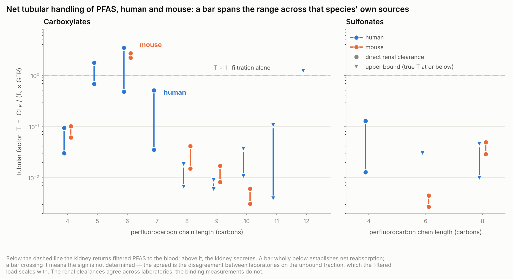
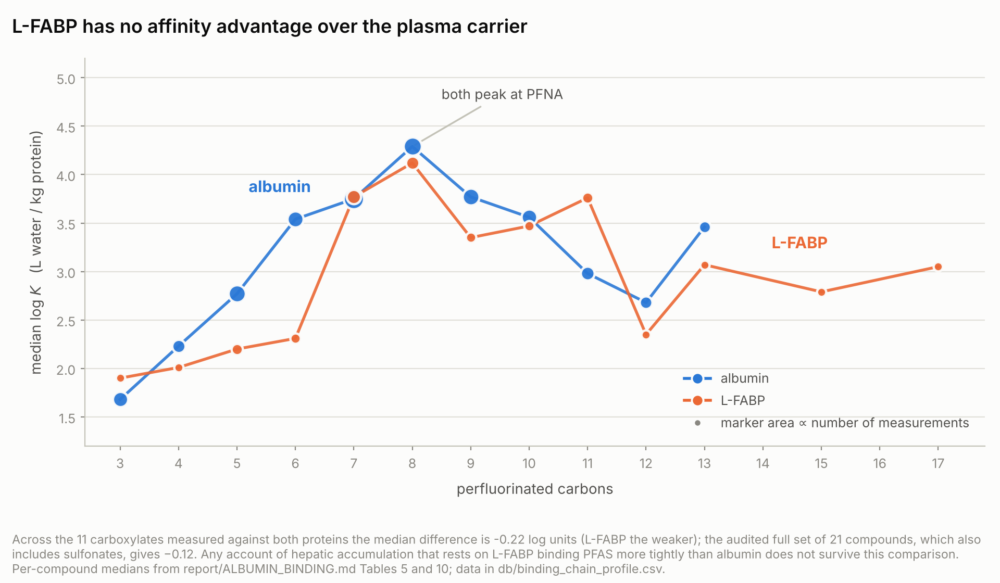

# PFAS toxicokinetics: albumin, L-FABP and renal transporters

### A briefing document

**Scope.** This combines three strands of the review — binding to serum
albumin, binding to liver fatty acid-binding protein, and renal transporters —
into one document, and connects them through the quantity they jointly
determine: how much of a filtered PFAS the kidney gives back.

**Deliberately excluded.** The QSAR fit is set aside for this round. In short:
with 46 usable rows, 31 of them one-sided bounds, no linear chain-length
coefficient reaches significance in any species (largest |z| = 1.93), and the
curvature that does appear in the human rests entirely on the two compounds
whose binding is disputed. It is not wrong, it is underpowered, and the thing
it is short of is measured renal clearances rather than cleverer descriptors.
That diagnosis is itself worth reporting — see §8.

---

## 0. The six things worth saying out loud

1. **The reabsorptive machinery is not the same genes in human and rat.**
   Human OAT4 is not detectable in rat kidney; rat Oatp1a1 is not detectable
   in human. Each species reabsorbs PFAS with a transporter the other lacks.
   This is a presence/absence difference, measured in one assay, not a
   difference of degree inferred across laboratories.

2. **L-FABP has no affinity advantage over albumin.** Per kilogram of protein
   the two are indistinguishable (median −0.12 log units across 21 compounds).
   Any account of hepatic accumulation resting on L-FABP binding PFAS *more
   tightly* than the plasma carrier fails at the first step.

3. **The binding literature disagrees with itself more than species differ.**
   Median within-compound range is 2.38 log units for albumin — a 240-fold
   choice. Human laboratories differ from each other by more than rat differs
   from human. **A species extrapolation factor cannot be estimated from this
   literature**, because the quantity it would correct for is smaller than the
   disagreement about it.

4. **Binding is not the bottleneck; renal clearance is.** The project holds
   1,497 binding measurements. They unlock exactly **zero** additional
   species-compounds on the renal endpoint, because the unbound fraction is
   already known wherever a clearance exists. (§6)

5. **There is more direct human renal clearance in the literature than the
   project has ingested** — about ten compounds, from four primary studies, of
   which eight would upgrade a bound into a measurement. But none of them
   covers the two compounds whose answer is actually in doubt. (§8)

6. **Published regulatory tables contain errors large enough to matter.**
   Eight documented; two change numbers by 8-fold and 40-fold. (§7)

---

## 1. The chain that connects the three strands

Everything below hangs on one identity. For a compound cleared by the kidney:

```
                     CL_R  =  f_u  ×  GFR  ×  T
                     \__/     \__/    \___/   \_/
                   what the   what   what the  what the
                   kidney     is     glomerulus tubule
                   removes    free   filters    does
```

Rearranged, **T = CL_R / (f_u × GFR)** — the *tubular factor*, the fraction of
the filtered load that survives the tubule and leaves in urine.

| T | meaning |
|---|---|
| T < 1 | the tubule returns PFAS to the blood — **net reabsorption** |
| T = 1 | filtration alone |
| T > 1 | the tubule adds PFAS to urine — **net secretion** |

This single equation is why the three strands cannot be studied apart:

- **Albumin binding** sets `f_u`, and therefore sets what is available to be
  filtered at all. It is in the denominator, so an error in binding propagates
  into T with full force and the opposite sign.
- **Transporters** are the mechanism of `T`. Reabsorptive transporters (OAT4
  in human, Oatp1a1 in rat) push T below 1; secretory ones (OAT1, OAT3) push
  it above.
- **L-FABP** sits outside this equation — it is intracellular and hepatic —
  and the reason it is in this document is that it is the standing explanation
  for where PFAS goes *instead* of being excreted.

**One warning that governs the whole document.** T is a lumped quantity:

```
            T  =  1 − FR  +  S / (f_u × GFR)
```

where FR is the reabsorbed fraction and S is secretory clearance. **Only the
combination is identifiable from in vivo data.** Splitting T into reabsorption
and secretion requires an independent measurement of one of them *in the same
species*. Scaled in vitro intrinsic clearance is not that measurement: the
expression gate and the choice of scaling factor move it about five-fold, and
the effect of albumin in the assay is unquantified. Where this document says
"net reabsorption", it means T < 1 — not that secretion is absent.

---

## 2. Serum albumin

`report/ALBUMIN_BINDING.md` · `db/protein_binding.csv` · `db/albumin_kd_to_k.csv`

**288 albumin–water partition coefficients for 63 PFAS from 20 primary
sources**, converted to one basis — log *K* in litres of water per kilogram of
protein — and audited against the primary publication in each case.

The conversion identity is explicit and checkable:

```
          log K  =  4.1774  +  log₁₀(n)  −  log₁₀(K_d / µM)
```

All 181 rows carrying both a dissociation constant and a stoichiometry satisfy
it exactly. That is a property of the compilation worth stating in a meeting:
the arithmetic is not where the uncertainty lives.

### 2.1 What the numbers look like

| | |
|---|---|
| range | log *K* 0.48 to 5.49 |
| median | 3.37 (IQR 2.46–4.13) |
| species split | 178 human, 110 bovine |

### 2.2 The dispersion is systematic, not random

Across the 32 compounds with three or more values, the **median
within-compound range is 2.38 log units** and the maximum is 4.22.

A modeller picking one published constant is making a choice with a
**240-fold range of defensible outcomes.** This is the central practical fact
about the albumin literature.

**Method is the principal axis.** Equilibrium dialysis and differential
scanning fluorimetry differ by **2.35 log units in median** — and in the
direction the physics predicts, since DSF measures thermal denaturation rather
than an equilibrium. These are not competing estimates of one quantity; they
are two quantities.

### 2.3 Chain length

Affinity rises with chain length to a maximum at **PFNA**, then declines:
**+0.52 log units per carbon from PFBA to PFNA**.

The decline beyond PFNA is attributed to steric constraint in albumin's
pockets and to falling aqueous solubility. Fischer's mechanistic statement is
the clearest: for the longest chains, *"reduced molecular flexibility limits
their accessibility to the HSA binding pockets."*

> **A defect to fix in the source document.** Table 5 of `ALBUMIN_BINDING.md`
> labels its chain-length column *n*_CF but the values in it are **total**
> carbons (it lists PFBA as 4). Table 10, for L-FABP, uses **perfluorinated**
> carbons (PFBA = 3), which is what `db/protein_binding.csv` stores. The two
> tables therefore appear to put the maximum at different chain lengths when
> in fact both put it at PFNA. Nothing downstream is wrong, but the label is,
> and it is the sort of thing that survives into a figure. **This document
> uses compound names rather than carbon counts wherever the convention could
> be ambiguous.**

### 2.4 Species

Human and bovine medians differ by 0.90 log units, bovine higher. **This should
not be read as a species difference**: the bovine subset is dominated by
microextraction and dialysis on long-chain compounds, the human subset contains
all 33 DSF values. The comparison is confounded with method and coverage, which
is why the two are kept separable in the delivered data rather than pooled.

---

## 3. Liver fatty acid-binding protein

`report/ALBUMIN_BINDING.md` §5 · figure `report/fig_binding_chain_profile.png`

**91 coefficients for 32 PFAS from ten sources**, on the same basis, using a
per-species bridge constant of **4.8475** for human L-FABP against albumin's
4.1774.

### 3.1 The comparison that matters

Twenty-one compounds have been measured against both proteins. The median
difference is **−0.12 log units**, L-FABP marginally the weaker — far inside
the dispersion of either compilation.

**Read this carefully, because it is easy to overstate.** It does *not* say the
two proteins are interchangeable in the body. Albumin sits in plasma at ~600 µM
and L-FABP in hepatocyte cytosol at 100–400 µM, in different compartments;
equal affinity per kilogram still gives very different capacity in context.

What it *does* say: **there is no intrinsic affinity advantage.** An explanation
of hepatic accumulation that requires L-FABP to out-bind the plasma carrier is
dead on this evidence.

### 3.2 The in vivo test points the same way

The one available in vivo test is a knockout: deleting L-FABP changes the mouse
liver partition coefficient by **under 20% for 15 of 19 PFAS**. An explanation
carrying the accumulation should not survive its own deletion that quietly.

### 3.3 A structural cause for part of the scatter

L-FABP has **two binding sites**, and most of its constants come from probe
displacement. Sources using a secondary-site probe and sources using a
primary-site probe **are not estimating the same quantity.** (Luebker's assay,
for instance, displaces DAUDA, which binds the secondary site — the paper says
so.) Part of the L-FABP dispersion is therefore structural rather than
experimental noise, and is fixable by stratifying on probe site.

Within-compound dispersion: median range 1.40 log units, maximum 3.30 for PFOA
across nine sources (log *K* 2.55 to 5.85). Better behaved than albumin, but on
half as many compounds.

### 3.4 Species, and a claim that does not survive

Restricting both sides to displacement assays, the rat-minus-human difference
depends entirely on which human source is the comparator:

| comparison | shared compounds | median rat − human |
|---|---|---|
| rat vs Zhang 2013 | 10 | **+0.50** |
| rat vs Sheng 2016 | 2 | **−0.71** |
| rat vs Sheng 2018 | 3 | −0.62 |
| rat vs Yang 2020 | 6 | −0.10 |
| rat vs Yang 2026 | 1 | −0.06 |

The five human sources disagree among themselves by 1.21 log units — PFOA alone
is 2.36 µM in one and 50.4 µM in another, **a factor of 21 between two human
laboratories.** That spread is wider than any rat–human gap and contains both
signs.

**The sign of the apparent species difference is set by the choice of human
comparator.** Pooled across all sources: +0.38 log over 13 shared compounds,
falling to −0.01 on the five compounds with four or more independent human
values — the signature of thin coverage, not biology.

Two published claims sit in opposition here and **neither survives cleanly**:
Modaresi 2025 (PFAS bind human FABP more strongly than rodent) holds against
exactly one human source on two compounds and reverses against the other three;
Fan 2025 (rat comparable to human) is near-exact against Yang 2020, which they
do not cite for it, while against Zhang 2013, which they do cite, the
difference is the largest of the four.

---

## 4. Renal transporters

`report/TRANSPORTERS.md` · `db/transporter_kinetics.csv` ·
`db/transporter_direction.csv` · `db/protein_abundance.csv`

### 4.1 Localisation is agreed; substrate identity is not

**299 of the 305 rows in `db/transporter_direction.csv` resolve to a
reabsorption-or-secretion call, across 21 distinct transporters, and the number
of genuine direction conflicts is zero.** (Five rows carry no parseable
direction and one is a combined two-transporter row; the apparent conflicts are
free-text variants of the same call — "secretion (basolateral)" against
"secretion (basolateral uptake into the proximal tubule cell)" — plus
"not operative here" qualifiers.)

That is a result in itself: papers that disagree sharply about *which
compounds* a transporter carries do not disagree at all about *where it sits*.
When reading this literature, **treat localisation as settled and substrate
lists as contested.**

> *Note for the record:* `report/TRANSPORTERS.md` states this as "343 of 363
> rows". No current data file has 363 rows and no script reproduces the figure,
> so the counts above were recomputed from the delivered file. The substantive
> claim — zero direction conflicts — is confirmed; the row counts in the older
> report are stale and should be corrected there.

### 4.2 Expression, measured in one assay across three species

Thakur 2024 quantified 78 enzymes and transporters in kidney membrane
fractions of human (n=15), rat (n=10) and mouse (n=14), both sexes. This is the
single most useful table in the strand, because it is **one assay** — the
species comparison is not assembled across laboratories.

pmol/mg membrane protein:

| transporter | role | human | rat | mouse |
|---|---|---|---|---|
| **Oat1** | basolateral, secretory | 4.8 ± 1.2 | **32.8 ± 13.7** | 19.1 ± 7.1 |
| **Oat3** | basolateral, secretory | 4.3 ± 1.1 | 6.3 ± 1.1 | 6.5 ± 3.6 |
| **OAT4** | apical, **reabsorptive** | **0.5 ± 0.2** | **not detected** | not detected |
| **Oatp1a1** | apical, **reabsorptive** | **not detected** | **1.9 ± 2.1** | 3.1 ± 2.8 |
| URAT1 | apical | 3.1 ± 1.2 | 2.2 ± 0.7 | 10.8 ± 1.1 |

*(URAT1 transports no PFAS in this compilation.)* Independent agreement where
sources overlap: human OAT1 4.8 (Thakur) against 5.3 (Niu 2026); P-gp 1.2
against 2.1; BCRP not detected in both.

**The two consequences, stated plainly:**

- **The secretory side is conserved in kind and differs in degree.** Both
  species have OAT1 and OAT3; the rat simply has 6.8× more OAT1.
- **The reabsorptive side is not the same machinery at all.** Human has OAT4
  and no Oatp1a1; rat has Oatp1a1 and no OAT4.

That second point is the single most important fact in the transporter strand,
because **reabsorption is what sets the long half-lives**, and it is the half
of the system that is not shared.

**Two long-standing disagreements dissolve.** ASBT and OSTα/β were not detected
in human *or* rat kidney, yet Zhao 2015 found transport by both in transfected
cells while Argoul 2026 found none. **Both are right.** A transfected-cell
result states what a protein *can* carry, not whether it is present to do it.
This distinction — capability versus presence — resolves more apparent
conflicts in this literature than any other single idea.

### 4.3 Abundance gates relevance

52 rows carry an intrinsic clearance; eleven can be scaled to the kidney. The
two scaling methods (relative expression, relative activity factor) **disagree
11-fold on OAT3 and in opposite directions**, so they are reported separately
and never averaged.

**The expression gate removes the compilation's three highest values** — all
BCRP, including **279 µL/min/mg for PFOA, the highest intrinsic clearance
anywhere in the table.** Human renal BCRP is not detected by either laboratory
that looked.

> **The fastest transporter in the dataset is one nobody can find in human
> kidney.** This is the cleanest illustration of why an in vitro clearance
> ranking is not a mechanistic ranking.

### 4.4 Reabsorption against secretion, within one laboratory

Louisse (2023 for OAT4, 2024 for OAT1/OAT3), measured and unscaled, µL/min/mg:

| compound | OAT4 (reabsorb) | OAT3 | OAT1 | OAT4 / OAT3 |
|---|---|---|---|---|
| PFHpA | 75.0 | 8.7 | 21.4 | 8.6 |
| PFHxS | 79.3 | 7.5 | — | 10.6 |
| PFOA | 95.7 | 16.7 | 30.8 | 5.7 |
| PFNA | 146.6 | 23.8 | — | 6.2 |
| PFOS | 45.8 | — | 53.5 | **0.9** |
| PFDA | 153.8 | — | — | |

Both sides rise with chain length (OAT3 2.7× from PFHpA to PFNA; OAT4 2.1×
from PFHpA to PFDA), **so chain length does not by itself tip the balance.**

What stands out is the level, and **it splits by head group**: for every
carboxylate, OAT4 carries 3.1–8.6 times the clearance of a secretory
transporter. PFHxS behaves like the carboxylates. **PFOS is the exception** —
OAT1 matches OAT4, and OAT3 does not transport it at all.

**The caveat that bounds all of this.** OAT4 cannot be scaled to the kidney and
OAT1/OAT3 can. Applying the expression factor lifts OAT1 to 118–334 µL/min/mg,
which would reverse the ordering. **The in vitro ratio is therefore not
evidence about the in vivo balance** — it is evidence about the proteins.

### 4.5 Transporter affinity is conserved where the transporter exists

Where a transporter is present in both species, affinity agrees to
**1.2–1.8-fold on OAT1 and OAT3**, measured in one expression system. The same
~500 g/mol threshold governs substrate interaction in both.

So the species difference is **not** in how well the shared transporters work.
It is in which transporters are present, and in how much of them there is.

### 4.6 The rat sex difference is a change of sign

Female rats **net-secrete** PFOA and PFNA; males do not. Established twice over
by routes sharing no assumptions:

- **Oatp1a1 is 114-fold more abundant in male rats** than female — the
  reabsorptive transporter, present in the sex that retains.
- **In vivo renal fractions** put the female above the secretion threshold and
  the male below it.

This is the clearest mechanism-to-outcome link anywhere in the project, and it
is worth holding up as the template for what the other species lack.

---

## 5. Where the strands meet: the tubular factor

`db/tubular_factor_consolidated.csv` (52 rows) ·
`db/tubular_factor_evidence.csv` (87 rows) ·
figure `report/fig_T_vs_chain_length.png`

### 5.1 Three tiers of evidence, and why the distinction is load-bearing

| tier | what is available | what it yields |
|---|---|---|
| **DIRECT** | renal clearance measured | T itself |
| **UPPER** | only total clearance | T ≤ CL_tot/(f_u·GFR) — **a bound below 1 proves reabsorption whatever the renal share**, since renal ≤ total |
| **LOWER** | measured renal fraction | secretion established once f_ren > (f_u·GFR)/CL_tot |

The UPPER tier is the workhorse and it is logically clean: if the *whole*
clearance is less than the filtered load, the tubule must be returning
material, no matter how the clearance divides between routes.

### 5.2 What is established

- **Long-chain PFAS are almost completely reabsorbed in the human.** PFOA
  through PFUnDA exceed **98% reabsorbed** on every unbound-fraction source
  available; PFHxS and PFOS reach **97.0%**. PFBS is the exception at 87%.
- **The rat/human tubular factor is of order 10²** — 22 to 161-fold across the
  four human and three rat clearance sources. Every combination leaves the
  tubule at least three-fold above the **6.8-fold glomerular factor**, so the
  dominance is secure and the number is not. **Quote it as an order of
  magnitude.**
- **The two rodents are fast for different reasons.** Against the human, the
  rat's difference is carried by the tubule and the mouse's by the glomerulus.
  "Rodents clear PFOA faster than humans" is one sentence covering two
  mechanisms — and it matters, because only one of them is a transporter story.

### 5.3 What is not established

- **The sign of human tubular handling for C5–C7.** See §6.
- **Whether human OAT4 reabsorbs more effectively in situ than rat Oatp1a1.**
  Per mg of transporter they are within 1.3-fold; per kidney they cannot be
  compared, because neither has a scaling factor.
- **Whether any measured in vitro clearance survives contact with plasma
  protein.** Every assay in this compilation was run without it. Given §2's
  finding that binding spans 240-fold, this is not a minor omission.
- **Anything about the monkey.** Fourteen clearances exist across six
  compounds; **no unbound fraction has ever been measured in cynomolgus plasma
  for any PFAS**, and the 1,497-row binding collection contains no macaque
  measurement of any kind.

---

## 6. The human unbound fraction: the decision, and what it actually decides

`db/human_fu_recommended.csv` (28 compounds)

Four **independent** human datasets exist. A fifth that looks independent is
not: **Abraham 2024's binding is Smeltz's**, by its own Table 4 footnote
("as published by Smeltz et al. (2023)"). Treating it as a fifth source would
double-count.

| dataset | method | compounds |
|---|---|---|
| **Smeltz 2023** | ultracentrifugation | 67 (US EPA) |
| **Fischer 2024** | solid-phase microextraction | 29 |
| **Argoul 2025** | Dianorm dialysis | 16 |
| **Ryu 2024** | presaturation dialysis | 14 |

### 6.1 The recommendation is by purpose, not a single winner

| use | source | why |
|---|---|---|
| **human absolute values (default)** | **Smeltz 2023** | 67 PFAS so no gaps; EPA's own; the method choice is *argued* — UC and RED run side by side on 22 compounds, with RED shown failing to equilibrate for high-mass, high-logK_ow PFAS; per-compound credible intervals |
| **individual variability** | **Fischer 2024** | measures albumin and globulin binding separately, returns f_u from a person's own protein concentrations, R² = 0.99 |
| **species ratios** | **Ryu 2024, and only Ryu** | the only dataset measuring human, rat and two mouse strains in one laboratory — in a *ratio*, a systematic method bias divides out |

**Do not use Ryu for human absolute values.** It runs high — 4× above Smeltz
for PFHxA, 15× above Fischer for PFPeA — and those are exactly the two
compounds in dispute.

Two caveats travel with Smeltz: **PFBS is 0.0046 in its Table 2 and 0.0128 in
its Table 3** (2.8× internal, same assay), and its PFOS value averages three
salt forms.

### 6.2 "Variable f_u" means three different things

1. **Variable across compounds.** Settled, and the single largest correction
   to the regulatory position: OEHHA's flat 0.02 against a measured range of
   0.0004 (PFHpA) to 0.31 (PFPA) — **a factor of 780 across the series.**
   Already implemented throughout this review.
2. **Variable across individuals.** The one worth adding. Fischer's equation
   returns f_u from measured albumin and globulin; f_u varies up to **2.5×
   across 1,919 NHANES participants**, widest below 500 g/mol — the
   short-chain range. The band is carried per compound in
   `human_fu_recommended.csv` (2.5× below 500 g/mol, 1.6× for 500–600, 1.3×
   above). **Check the direction before using it:** higher f_u means a higher
   filtered load and *faster* elimination, so the individuals with the
   **lowest** f_u carry the longest half-lives. For a health-protective value
   the low tail is the sensitive one.
3. **Variable with concentration.** Real — binding goes non-linear above a
   PFAS:protein molar ratio near 0.1 — but environmental exposures sit near
   0.0005. This matters for *comparing in vitro datasets*, not for human
   dosimetry. Lowest priority.

### 6.3 What the choice actually decides: two compounds

Human PFHxA, same clearance, four binding datasets:

| f_u source | T | verdict |
|---|---|---|
| Smeltz 2023 | 3.47 | net secretion |
| Fischer 2024 | 2.48 | net secretion |
| Argoul 2025 | 1.18 | net secretion |
| **Ryu 2024** | **0.62** | **net reabsorption** |

**Ten of the twelve PFAS with enough data give the same tubular sign on every
binding dataset, and all ten are reabsorption.** The disagreement is confined
to **PFPeA and PFHxA**. The decision is far narrower than the 780-fold spread
in f_u makes it look — but it is not cosmetic, because those two compounds also
decide whether the human chain-length relationship is monotone or humped.

---

## 7. Errors found in the source and regulatory literature

Eight documented in `report/TRANSPORTERS.md` §9. The ones with reach:

| # | error | size |
|---|---|---|
| 1 | **ATSDR 2021 Table 3-6 misreports Ohmori 2003.** Rat PFDA total clearance printed as 207/140 against the paper's 5.2/5.3; male PFOA 135 against 50.5 | **40×**, 26×, 2.7× |
| 2 | **OEHHA PHG Table A6.4 assumes f_u = 0.02 for every species, uncited.** Measured values are 0.0025 (human), 0.0030 (rat) — filtered loads, and the printed reabsorption percentages, are wrong in the denominator | ~**8×** |
| 3 | Nakagawa 2008 Table 1 carries a units defect in a K_m/V_max column | — |
| 4 | Niu 2026 transposes P-gp and BCRP between text and abstract | — |
| 5 | Argoul 2026's citation for its unbound fractions does not resolve | — |
| 6 | Abraham 2024 misquotes Smeltz in its own Discussion | — |
| 7 | Smeltz 2023 reports PFBS twice, 2.8-fold apart | 2.8× |
| 8 | **`pdftotext` silently drops the micro sign** — caught twice in this project (fmol/µg→fmol/mg; 48.64 µmol/kg→mmol) | 1000× |

**Error 8 is a methods warning, not a literature error, and it is the one most
likely to bite someone else.** It is undetectable by eye and detectable by
arithmetic: a value that is 1000-fold out of line with its neighbours is a
dropped prefix until proven otherwise.

**A number that should stop being quoted:** the male rat's PFOA reabsorption of
93.7%. Three rat studies give T = 0.42 to 1.07 on OEHHA's GFR and 0.77 to 1.95
on the rate Ohmori cites. **At most half the filtered load is returned,
possibly none.**

---

## 8. The literature search: is there more direct renal clearance?

`db/renal_clearance_leads.csv` · `scripts/stage12_renal_clearance_leads.py`

**Short answer: yes, roughly ten compounds' worth, and it has never been
ingested.** The human DIRECT tier currently holds **two** compounds (PFBS and
PFHxA, both Argoul). Everything else human is an upper bound from total
clearance.

### 8.1 What was found

EFSA's 2020 Opinion tabulates human renal clearances for ten compounds from
four primary studies:

- **Zhang 2013** — 86 paired blood/urine samples, adults in China,
  isomer-specific. The widest-coverage human source.
  [10.1021/es401905e](https://doi.org/10.1021/es401905e)
- **Fujii 2015** — renal, biliary and faecal clearances in humans
- **Harada 2005** — PFOA and PFOS, young/old × M/F, n=5 per cell.
  [10.1016/j.envres.2004.12.003](https://doi.org/10.1016/j.envres.2004.12.003)
- **Harada 2007** — follow-up

*(Bibliographic details for Zhang 2013 and Harada 2005 retrieved from PubMed.)*

### 8.2 Why they are **not** yet in the pipeline

Two reasons, each disqualifying on its own:

1. **The secondary source contradicts itself.** Two passages of the *same* EFSA
   document give different values for the same compounds — PFHpA 0.61 vs 0.67,
   and **PFUnDA 0.064 vs 0.005, a 13-fold difference.** That is not rounding.
2. **Some values exceed independently reported total clearances.** EFSA's PFOA
   renal range (0.13–0.77 mL/kg·day) sits **3- to 18-fold above** Abraham
   2024's measured *total* clearance for PFOA (0.0417) and Argoul's (0.042).
   Different cohorts, so not a strict contradiction — but a gap that large
   between one group's renal part and another's whole has to be understood
   before either is used.

### 8.3 Would they change anything? — the decision aid

Provisional T, computed on the project's own human f_u and GFR, **clearly
marked as not-yet-admitted**:

| compound | CL_R (mL/kg·d) | provisional T | now held as |
|---|---|---|---|
| PFHxS | 0.027–0.039 | 0.015–0.022 | bound |
| PFHpA | 0.61 | 0.053 | bound |
| PFOA | 0.13–0.77 | 0.021–0.122 | bound |
| PFOS | 0.037–0.106 | 0.019–0.055 | bound |
| PFNA | 0.062–0.25 | 0.013–0.052 | bound |
| PFDA | 0.066–0.096 | 0.042–0.060 | bound |
| PFUnDA | 0.064–0.065 | 0.059–0.060 | bound |
| PFDoDA | 0.070 | 0.259 | bound (currently uninformative) |
| PFTriDA | 0.077 | no human f_u | absent |
| PFTeDA | 0.224 | no human f_u | absent |

**Eight would upgrade from a bound to a measurement** — which is the scarce
thing. **All eight point the same way the project already concludes.** So the
*direction* is not at stake; what these buy is evidence tier and magnitude.

**And the honest limitation:** none of these covers **PFPeA or PFHxA** — the
two compounds whose sign is actually disputed. This literature strengthens the
part that was never in doubt and leaves the open question open.

### 8.4 Recommended next step

Three PDFs would land most of this: **Zhang 2013, Fujii 2015, Harada 2005.**
The pattern that has worked in this project is for primary PDFs to be supplied
and read directly rather than taken from a secondary tabulation — it is how the
Ohmori, Smeltz and Abraham numbers were landed, and in each case reading the
primary changed something.

---

## 9. Discussion questions, with suggested directions

These are the ones worth meeting time. Each carries a **suggested direction** —
a position to argue from, not a settled answer. Where the evidence does not
support a position, that is said.

### 9.1 On the species difference

---

**Q1. If the two rodents are fast for different reasons — the rat at the
tubule, the mouse at the glomerulus — which is the right model for human
reabsorption, and does "rodent" mean anything as a category here?**

> **Suggested direction.** Neither is a model of human *mechanism*, and the
> category "rodent" should be retired from this argument. The human reabsorbs
> with OAT4, which neither rodent has. The rat reabsorbs with Oatp1a1, which
> the human lacks. A rat-to-human extrapolation of reabsorption is therefore
> an extrapolation between two different proteins that happen to do similar
> jobs — defensible as an empirical scaling, indefensible as a mechanistic one.
>
> The practical consequence: **use the rat for the magnitude of the tubular
> effect and never for its mechanism.** If a PHG argument depends on *which
> transporter* does the reabsorbing, the rat cannot support it. If it depends
> only on *how much* is reabsorbed, the rat is usable with an uncertainty
> factor that reflects the 22–161-fold spread, not a point estimate.

---

**Q2. The rat sex difference is a change of sign, not of degree. If sex can
flip the sign within one species, what is the defensible way to pick a single
human value?**

> **Suggested direction.** This is the strongest argument in the whole project
> *against* point estimates, and it should be used as such. Female rats
> net-secrete PFOA; males net-reabsorb it; the mechanism is a 114-fold
> difference in one apical transporter. Nothing about human physiology
> guarantees the human sits at a stable point on that axis.
>
> Two defensible positions, and they are not the same:
> - **Health-protective:** take the slowest-eliminating configuration, which
>   means the lowest f_u and the strongest reabsorption. Defensible for a PHG.
> - **Central-estimate:** report the range and refuse the point. Defensible
>   for a dosimetry model feeding an epidemiological analysis.
>
> What is *not* defensible is a single value presented without saying which of
> these it is. Ask the room which one the current number is meant to be —
> often the answer is that nobody has decided.

---

**Q3. Which species should we actually be arguing about?** No unbound fraction
has ever been measured in cynomolgus plasma, yet the monkey supplies fourteen
clearances and is the usual bridge species.

> **Suggested direction.** The monkey is the highest-value and cheapest gap in
> the entire project. Six compounds have clearance and none has binding;
> the 1,497-row binding collection contains **no macaque measurement of any
> kind**. A single dialysis or ultracentrifugation run on cynomolgus plasma
> across six compounds — one afternoon of bench work — would convert fourteen
> orphan clearances into fourteen tubular factors in the species that is
> physiologically closest to the human of any with in vivo data.
>
> **If one experiment comes out of this meeting, argue for this one.**

---

### 9.2 On the unbound fraction

---

**Q4. Is a single f_u defensible at all any more?** OEHHA Table A6.4 assumes
0.02 for every species and every compound.

> **Suggested direction.** No, and this is the clearest correction available.
> The measured range across the series is **0.0004 to 0.31 — a factor of 780**
> — and 0.02 is not close to the middle of it for the compounds that matter
> most. For PFOA the measured human value is 0.0025, eight-fold below the
> assumption, which means the filtered load used in the PHG is eight-fold too
> high and every reabsorption percentage derived from it is wrong in the
> denominator.
>
> The correction is not controversial and does not require new data. It
> requires replacing one constant with a table that already exists
> (`db/human_fu_recommended.csv`).

---

**Q5. Variable f_u — in which of the three senses, and which does a PHG need?**

> **Suggested direction.** Separate them explicitly, because they have
> different costs and different readiness:
> - **Across compounds** — do it now, it is settled and large (780×).
> - **Across individuals** — do it next, it is 2.5× and widest exactly where
>   the short chains sit. **But get the direction right:** higher f_u means
>   faster elimination, so the sensitive individuals are the **low**-f_u tail,
>   not the high. This trips people up, and a model that takes the upper
>   percentile of f_u to be protective is protective of the wrong person.
> - **With concentration** — not needed for human dosimetry at environmental
>   exposures (molar ratio ~0.0005 against a non-linearity threshold near 0.1).
>   It matters only when reconciling in vitro datasets run at high loading.

---

**Q6. Low albumin as a susceptibility factor — is this real, and is it
actionable?**

> **Suggested direction.** Mechanistically it must be real: f_u is set by
> albumin and globulin concentrations, and Fischer's equation reproduces it at
> R² = 0.99. But the direction cuts against intuition. Low albumin raises f_u,
> which raises the filtered load and *speeds* elimination. So
> hypoalbuminaemia predicts **lower** PFAS body burden at steady state, not
> higher — while simultaneously raising the free concentration available to
> tissues at any given total concentration.
>
> **These two effects oppose each other, and which dominates depends on
> whether the toxicological driver is the total body burden or the free
> concentration.** That is a genuinely open question and a good one to put to
> the room, because the answer determines whether low albumin is a
> susceptibility factor or a protective one.

---

### 9.3 On the transporters

---

**Q7. Does any measured transport survive contact with plasma protein?**
Every in vitro assay in the compilation was run without it.

> **Suggested direction.** Unknown, and it is the largest unquantified caveat
> in the transporter strand. The concern is concrete: transporters see the
> free concentration, binding spans 240-fold between laboratories, and an
> assay run protein-free is presenting the transporter with a free fraction of
> 1 against an in vivo value near 0.0025 for PFOA — **a 400-fold difference in
> the quantity the protein actually responds to.**
>
> This does not necessarily invalidate the *rankings* (if binding affects all
> compounds similarly it may largely divide out), but it does invalidate the
> *magnitudes*, and any IVIVE that scales these clearances to a kidney without
> a binding correction is overstating them. **Ask whether anyone has run even
> one transporter assay at physiological albumin.** If not, that is the second
> experiment to argue for.

---

**Q8. Abundance versus affinity — which should gate inclusion in a model?**
The highest intrinsic clearance in the compilation (BCRP, 279 µL/min/mg for
PFOA) belongs to a transporter two laboratories cannot detect in human kidney.

> **Suggested direction.** Abundance gates, and it should gate *first*. A
> transfected-cell result states what a protein **can** carry; it says nothing
> about whether the protein is **present** to do it. Applying this one rule
> dissolves two long-standing disagreements in this literature (ASBT and
> OSTα/β — Zhao found transport, Argoul found none, and both are right).
>
> Recommend an explicit two-gate rule for any model built from this
> compilation: **(1) is it expressed in the tissue, at what abundance; (2)
> does it transport the compound.** Papers routinely report (2) and omit (1).

---

**Q9. Is secretion the minor term we treat it as?** Mouse PFHxA is net
secreting at T = 2.2; rat PFHpA and female rat PFOA run well above 1.

> **Suggested direction.** No — and the framing of PFAS renal handling as
> "reabsorption, with some filtration" is a long-chain generalisation that
> does not survive contact with the short chains. For C4–C7 the secretory
> transporters can dominate, and in the rat the sign is sex-dependent.
>
> Practical consequence: a model that hard-codes reabsorption-only kinetics
> will be wrong in sign for the short chains, which are exactly the compounds
> now entering regulatory attention. **The structure of the model, not just
> its parameters, is chain-length dependent.**

---

**Q10. What is the minimum transporter dataset for a defensible IVIVE?**

> **Suggested direction.** On the evidence here, four things, and the strand
> currently has at most three of them for any transporter:
> 1. abundance in the target tissue, in the target species, by a quantitative
>    method (Thakur-style), *not* mRNA;
> 2. intrinsic clearance for the compound, in a system where the expressed
>    amount is known;
> 3. a scaling factor from the expression system to the kidney — **OAT4 has
>    none, which is why the OAT4/OAT1 comparison cannot be taken in vivo**;
> 4. the assay run at physiological binding, or a stated correction.
>
> Note that the two available scaling methods disagree 11-fold on OAT3 and in
> opposite directions, so item 3 is not a solved problem even where it exists.
> **Arguing for an agreed scaling convention may be more valuable than more
> measurements.**

---

### 9.4 On meeting the regulatory numbers

---

**Q11. Two secondary-source errors have regulatory reach. What is the process
response?**

> **Suggested direction.** The specific corrections (ATSDR's 40-fold PFDA,
> OEHHA's flat f_u) are worth reporting to the agencies, but the process point
> is larger: **both errors are of a kind that reading the primary source
> catches immediately and that no amount of cross-checking between secondary
> sources would ever catch**, because the secondary sources copy each other.
>
> Suggest a standing rule for the group: **any number entering a PHG
> calculation is read from the primary publication, and the primary is
> recorded alongside it.** This project found eight errors by applying exactly
> that rule, and in three cases the error was in a document that had already
> been through formal review.

---

**Q12. Where does the renal framework stop?** 58–61% of human PFOA elimination
is not renal.

> **Suggested direction.** Say this out loud early in any renal discussion, so
> the tubular work is not asked to carry more than it can. The renal axis
> explains the *species differences* in elimination well and explains the
> *absolute* human half-life only partially. Biliary and faecal routes, and
> menstrual loss in women of reproductive age, carry the rest.
>
> This is not a weakness of the renal work — it is a scope statement. But a
> mass-balance model that closes only on renal clearance will be wrong by more
> than a factor of two in the human, and that should be stated before someone
> discovers it downstream.

---

**Q13. What would change our minds?** Stated in advance.

> **Suggested direction.** Commit to these before the data arrives:
> - **A cynomolgus f_u measurement** would convert the monkey from absent to
>   the best-characterised bridge species. (Highest value, lowest cost.)
> - **A primary reading of Zhang 2013 / Fujii 2015 / Harada 2005** would move
>   eight human compounds from bound to measured — or would reveal that the
>   13-fold internal inconsistency in EFSA's tabulation reflects a real
>   problem in the primaries, which would be just as informative.
> - **A transporter assay at physiological albumin** would tell us whether the
>   entire in vitro clearance compilation transfers.
> - **An independent human f_u measurement for PFPeA and PFHxA** would settle
>   the only two compounds whose sign is in dispute.
>
> Note what is *not* on this list: more binding measurements on compounds that
> already have them. The project has 1,497 and they unlock nothing further.

---

## 10. Figures, data and code

Every figure is generated by a script that holds **no data of its own** — the
numbers live in a CSV you can edit, and re-running the script redraws the
figure. This was not true a week ago: the tubular figure carried a hardcoded
copy of its data and silently kept drawing stale numbers after the pipeline
moved. Both figures now read from files.

### 10.1 Figure 1 — Net tubular handling across three species



| | |
|---|---|
| **image** | `report/fig_T_vs_chain_length.png` |
| **script** | `scripts/stage6_figure_T_vs_chain.py` |
| **data** | `db/tubular_factor_consolidated.csv` (coloured bars) |
| | `db/human_tubular_sign_by_fu_source.csv` (grey whiskers) |
| **rebuild** | `python3 -I scripts/stage6_figure_T_vs_chain.py` |

**Reading it.** Below the dashed line the kidney returns filtered PFAS to the
blood; above it, the kidney secretes. **Two different spreads are drawn, and
they must not be conflated:**

- a **coloured bar** spans that species' own *clearance* sources, under a
  single unbound fraction;
- a **grey whisker** spans the four human *f_u* datasets, with the clearance
  held fixed.

The grey whiskers are the wider ones — which is the visual statement of §2 and
§6: the renal clearances agree across laboratories and the binding
measurements do not.

### 10.2 Figure 2 — Albumin and L-FABP against chain length



| | |
|---|---|
| **image** | `report/fig_binding_chain_profile.png` |
| **script** | `scripts/fig_binding_chain_profile.py` |
| **data** | `db/binding_chain_profile.csv` — **a small, hand-editable file** |
| **rebuild** | `python3 -I scripts/fig_binding_chain_profile.py` |

The data file is 24 rows of
`protein, chemical, n_perfluorinated_carbons, median_logK, n_values`, with
commented provenance at the top. Add a compound, change a median, or drop a
series by editing that file alone. Marker area is proportional to the number
of underlying measurements, so a point resting on one value cannot read as
firmly as one resting on 25.

> Both series are plotted on **perfluorinated** carbons. If you compare this
> figure against Table 5 of `ALBUMIN_BINDING.md`, note that table's column is
> labelled *n*_CF but holds **total** carbons — see §2.3.

### 10.3 The data files behind this document

| file | rows | what it is |
|---|---|---|
| `db/protein_binding.csv` | 1,497 | every binding measurement, all proteins and species |
| `db/albumin_kd_to_k.csv` | 119 convertible | albumin K_d → log *K*, with the saturation and ratio diagnostics |
| `db/binding_chain_profile.csv` | 24 | **figure 2's source — edit this one** |
| `db/transporter_kinetics.csv` | — | intrinsic clearances, tier-graded |
| `db/transporter_direction.csv` | 305 | transporter × membrane × net process |
| `db/protein_abundance.csv` | — | Thakur and Niu expression, pmol/mg |
| `db/tubular_factor_consolidated.csv` | 52 | **the authoritative T table** |
| `db/tubular_factor_evidence.csv` | 87 | every underlying clearance row, superseded values included |
| `db/human_fu_recommended.csv` | 28 | the f_u recommendation, with per-compound variability bands |
| `db/clearance_fu_coverage.csv` | 46 | which species-compounds have clearance, f_u, binding |
| `db/renal_clearance_leads.csv` | 10 | **§8's candidates, not yet admitted** |

### 10.4 Rebuilding everything

```bash
cd tk_review
python3 -I scripts/stage11_fujii_mouse_longchain.py    # must precede stage6
python3 -I scripts/stage11b_clearance_fu_coverage.py
python3 -I scripts/stage6_consolidate_tubular.py
python3 -I scripts/stage9b_build_recommended_fu.py
python3 -I scripts/stage12_renal_clearance_leads.py
python3 -I scripts/stage6_figure_T_vs_chain.py
python3 -I scripts/fig_binding_chain_profile.py
```

Run in that order; each reads the outputs above it. All are idempotent and
verified byte-identical across two consecutive full runs.

> **Do not loop over `scripts/*.py`.** That re-runs one-shot ingestion scripts
> and duplicates rows in `db/protein_binding.csv`.

---

## 11. One-paragraph summary for anyone who reads nothing else

PFAS renal elimination is governed by the product of three terms — the free
fraction, the filtration rate, and what the tubule does. The binding
literature that sets the first term disagrees with itself by 240-fold, more
than species differ, so **no species extrapolation factor for binding can be
estimated from it.** The transporter literature that explains the third term
shows the reabsorptive machinery is **not the same protein in human and rat**,
so rodent reabsorption data carries magnitude but not mechanism. L-FABP, the
standing explanation for hepatic accumulation, turns out to bind PFAS no more
tightly than albumin does, so that explanation needs replacing. The project's
1,497 binding measurements cannot extend the renal endpoint any further
because **the binding term is not the one that is missing** — renal clearance
is, and roughly ten human compounds' worth of it sits in the literature
un-ingested. Three PDFs would land most of it.
