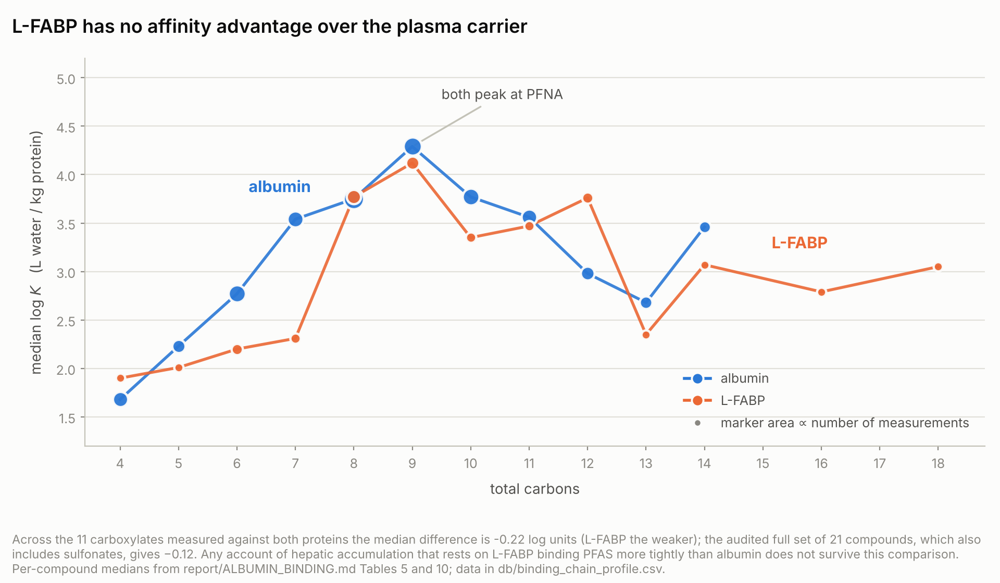

# The renal axis of PFAS toxicokinetics: an integrated treatment of serum albumin binding (288 measurements, 20 sources), liver fatty acid-binding protein (91 measurements, 10 sources) and renal transporter expression and kinetics (305 directional rows, 52 intrinsic clearances), resolved onto a single tubular factor for 52 species–compound pairs

## Abstract

The renal elimination of per- and polyfluoroalkyl substances (PFAS) is the
product of three terms — the unbound fraction in plasma, the glomerular
filtration rate, and the net effect of the renal tubule — and these are
studied in three literatures that do not usually meet. We assemble them onto
one identity, CL_R = f_u × GFR × T, where the dimensionless tubular factor
T = CL_R/(f_u × GFR) is the fraction of the filtered load that survives the
tubule, and we derive it from first principles so that the grouping can be
scrutinised rather than assumed. Binding to serum albumin sets f_u: across
288 albumin–water partition coefficients for 63 PFAS from 20 primary sources,
converted to a common basis and audited against the primary publication, the
median within-compound range is 2.38 log units, so selecting a single
published constant is a decision with a 240-fold range of defensible
outcomes, and the disagreement within one species exceeds the difference
between species. A rat-to-human extrapolation factor for binding therefore
cannot be estimated from this literature. Liver fatty acid-binding protein,
the standing explanation for hepatic accumulation, is indistinguishable from
albumin per unit protein mass across the 21 compounds measured against both
(median difference −0.12 log units), and deleting it changes the mouse liver
partition coefficient by under 20% for 15 of 19 PFAS, so any account
requiring L-FABP to out-bind the plasma carrier fails. Transporters supply the
mechanism of T: in a single assay across three species, the secretory side is
conserved in kind and differs in degree, while the reabsorptive side is not
the same machinery at all — human OAT4 is undetectable in rat kidney and rat
Oatp1a1 is undetectable in human. Reabsorption sets the long half-lives and is
the half of the system that is not shared, so rodent reabsorption data carries
magnitude but not mechanism. Resolving 52 species–compound pairs onto T, we
find long-chain reabsorption in the human exceeds 98% on every binding source
available, the rat/human tubular factor is of order 10² (22 to 161-fold), and
the sign for C5–C7 in the human is undetermined because it depends on which
of four binding datasets is used. We document eight errors found in the source
and regulatory literature, two with regulatory consequence, and we show that
the project's 1,497 binding measurements cannot extend this endpoint further,
because the scarce term is renal clearance and not binding.

**Keywords:** PFAS; toxicokinetics; renal clearance; tubular reabsorption;
serum albumin; liver fatty acid-binding protein; organic anion transporters;
unbound fraction; interspecies extrapolation

---

## 1. Introduction

Several PFAS have human elimination half-lives measured in years, and that
single fact drives their regulatory significance. The half-life is set
principally by the kidney, and the kidney's handling of a PFAS decomposes into
three physically distinct steps: how much of the circulating compound is free
to be filtered, how fast the glomerulus filters it, and what the tubule does
to the filtrate afterwards.

These three steps are studied by three communities. Protein binding is
measured in vitro by analytical chemists and reported as dissociation
constants or partition coefficients. Transporter kinetics are measured in
transfected cell systems and reported as intrinsic clearances. Renal clearance
is measured in vivo and reported in volume per time. The three literatures use
incompatible units, disagree internally to different degrees, and are rarely
reconciled against each other.

This document reconciles them. Section 2 derives the identity that connects
them and states the rules by which evidence is admitted; sections 3 to 5
present each strand on its own terms; sections 6 and 7 resolve them onto the
tubular factor and address the one parameter choice that changes a
conclusion. Sections 8 and 9 concern the quality of the source literature and
what remains un-ingested in it.

Three features of this treatment are worth stating at the outset because they
determine what can and cannot be concluded.

**First, the tubular factor is a lumped quantity and is left lumped.**
Reabsorption and secretion operate simultaneously in the same tubule, and no
in vivo measurement separates them. We make the non-identifiability explicit
(§2.3) rather than resolving it by assumption, which is the usual practice.

**Second, no row mixes species.** The unbound fraction, the filtration rate
and the clearance in any computed T must come from one species, enforced by
the build rather than by care (§2.6). Cross-strain joins within a species are
permitted and recorded.

**Third, exclusions carry as much information as inclusions.** Values removed
by the expression gate, superseded regulatory figures, and candidate
clearances that failed admission are all retained in the delivered data and
reported here, because in work of this kind the reader needs to see what was
rejected and why.

---

## 2. Theory and methods

### 2.1 Clearance, and the three renal processes

Clearance is the volume of plasma that would have to be completely stripped of
a substance per unit time to account for the observed rate of removal:

```
                         rate of removal  (mass / time)
          clearance  =  ────────────────────────────────
                         plasma concentration  (mass / volume)
```

It is a virtual volume per time. The body does not clear some volumes
completely and leave others untouched; it removes a little from all the blood
passing through, and clearance is the bookkeeping device that converts "a
little from a lot" into one number. Throughout this document clearances are
scaled to body weight, in mL/kg/day, so that a 25 g mouse and a 70 kg human
appear in the same table.

The definition matters for one structural reason: **clearance is additive
across organs.** The kidney clears, the liver clears, the gut clears, and
total clearance is their sum. Fractions removed per day do not add that way.
This additivity is what permits the statement in §6.5 that 58–61% of human
PFOA elimination is not renal.

A nephron handles a solute in up to three ways.

```
   blood in
      │
      │   ① GLOMERULAR FILTRATION
      │      Blood is pushed against a sieve. Water and small solutes pass
      ▼      into the tubule. Cells and PROTEINS do not.
   ┌──────────────┐
   │  glomerulus  │──────────► filtrate enters the tubule
   └──────────────┘                      │
      │                                  │
      │  blood continues                 │   ② TUBULAR REABSORPTION
      │  past the tubule                 │      Transporters in the tubule
      │                                  │      wall pull substance BACK
      │◄─────────────────────────────────┤      into the blood.
      │                                  │
      │   ③ TUBULAR SECRETION            │
      ├─────────────────────────────────►│      Transporters push additional
      │                                  │      substance INTO the tubule,
      ▼                                  ▼      from blood that was never
   blood out                           urine    filtered.
```

The glomerular sieve has a molecular-weight cut-off far below albumin's
66,500 Da. **A PFAS molecule bound to albumin therefore cannot be filtered** —
the carrier will not pass. Only the free molecules do. This is the structural
reason the binding literature of §3 is part of a renal document at all.

Reabsorption (②) returns filtrate to the blood and is, for PFAS, the dominant
process. Secretion (③) adds to the urine from blood that was never filtered.
The two run in opposite directions in the same tubule at the same time.

### 2.2 Derivation of the tubular factor

Let `C` be the total plasma concentration, `f_u` the unbound fraction, and
`GFR` the glomerular filtration rate. The free concentration is `f_u × C` and
the filtrate is produced at rate `GFR`, so the **filtered load** is

```
          filtered load  =  GFR × f_u × C          (mass / time)
```

If every filtered molecule left in the urine and nothing else occurred, the
removal rate would be `GFR × f_u × C`; dividing by `C` gives the clearance of
a kidney that is only a sieve:

```
          CL_filtration-only  =  f_u × GFR         (volume / time)
```

This is the yardstick for everything that follows. Now let `FR` be the
fraction of the filtered load that the tubule reabsorbs (0 ≤ FR ≤ 1) and `S`
the clearance contributed by secretion. Material reaching the urine per unit
time is

```
   urinary rate  =  GFR × f_u × C × (1 − FR)  +  S × C
```

and dividing by `C`,

```
          CL_R  =  f_u × GFR × (1 − FR)  +  S
```

Factoring out the filtered load clearance collects everything the tubule does
into a single dimensionless bracket:

```
          CL_R  =  f_u × GFR × [ (1 − FR)  +  S / (f_u × GFR) ]
                   └────┬────┘   └──────────────┬─────────────┘
                     the sieve            the tubule
```

which we name the **tubular factor**, `T`:

> ### CL_R = f_u × GFR × T
> ### T = CL_R / (f_u × GFR) = (1 − FR) + S / (f_u × GFR)

| `T` | interpretation | mechanism |
|---|---|---|
| **T < 1** | the kidney excretes **less** than it filtered | net **reabsorption** |
| **T = 1** | the kidney excretes exactly what it filtered | filtration alone |
| **T > 1** | the kidney excretes **more** than it filtered | net **secretion** |

### 2.3 Why this grouping, and what it cannot do

Three properties justify the choice.

**It isolates the unmeasurable term.** `f_u` is measurable in vitro, `GFR` is
a physiological constant per species, and `CL_R` is measurable in vivo. `T` is
the only term not directly measurable, so collecting the ignorance in one
place and solving for it is the honest construction.

**It is dimensionless, so it compares across species.** Rat PFOA clearances
are in the thousands of mL/kg/day and human ones in the hundredths; those
numbers cannot be compared, but their `T` values can.

**It separates two reasons a species can be fast** — filtering more
(`f_u × GFR` large) or giving back less (`T` large). These are different
mechanisms with different implications, and §6.4 shows the rat and the mouse
differ from the human by one each.

**What it cannot do is separate reabsorption from secretion.** The defining
equation has two unknowns, `FR` and `S`, and one equation. A `T` of 0.019 is
equally consistent with 98.1% reabsorption and no secretion, or 99.5%
reabsorption plus some secretion, or any other pair on that line. Splitting
them requires an independent measurement of `FR` or `S` **in the same
species**; scaled in vitro intrinsic clearance is not such a measurement,
because the expression gate and the choice of scaling factor move it about
five-fold (§5.3) and the effect of albumin in the assay is unquantified
(§5.6). **Where this document reports "net reabsorption" it means T < 1; it
does not mean secretion is absent.**

#### 2.3.1 Relation to the subtraction form used in regulatory documents

OEHHA's Public Health Goal computes reabsorption as the difference
`f_u × GFR − CL_R`, and prints it as a percentage. The two formulations are
algebraically equivalent:

```
                    f_u·GFR − CL_R                CL_R
  % reabsorbed  =  ────────────────  × 100  =  (1 − ───────) × 100  =  (1 − T) × 100
                       f_u·GFR                     f_u·GFR
```

Both published figures reproduce exactly from the subtraction under OEHHA's
assumed f_u of 0.02: male rat PFOA 93.68% (filtered load 288.0, difference
269.8 mL/kg/day) and human PFOA 99.77% (filtered load 51.4, difference 51.28).

The ratio form is nonetheless preferred here for four reasons.

1. **The difference cannot represent secretion.** When `CL_R > f_u × GFR` it
   goes negative, and "percent reabsorbed" becomes meaningless: female rat
   PFOA would read −2356% and mouse PFHxA −123%, against T = 24.6 and
   T = 2.23 respectively. Net secretion is not a corner case in this dataset.
2. **The difference has units and so does not compare across species** — 270
   mL/kg/day in the rat against 51 in the human.
3. **It is a difference of similar numbers near the decision boundary.** When
   `CL_R ≈ f_u × GFR`, a small error in f_u flips its sign; the ratio
   approaches 1 smoothly.
4. **The label over-claims.** Since `excreted = filtered − reabsorbed +
   secreted`, the quantity `filtered − excreted` is `reabsorbed − secreted`, a
   net term. Calling it "percent reabsorbed" names it after one of two
   unresolved components; `T` does not.

The published 93.7% is not wrong because of the formula. Recomputed with the
measured rat f_u of 0.00298 rather than the assumed 0.02, the same subtraction
gives **57.6%** (§8, error 2).

### 2.4 Worked example

The human GFR of 2570 mL/kg/day used throughout is not an arbitrary constant:
125 mL/min × 1440 min/day ÷ 70 kg = 2571 mL/kg/day.

For human PFOA, with `f_u` = 0.00245 (Ryu 2024a) and a total clearance of
0.120 mL/kg/day (US EPA 2024):

```
    filtered load clearance  =  0.00245 × 2570  =  6.30 mL/kg/day
    T                        =  0.120 / 6.30    =  0.0191
    reabsorbed               =  (1 − 0.0191)    =  98.1%
```

Two features of this calculation generalise. First, the input is a **total**
clearance, and renal clearance can only be smaller, so the result is the bound
`T ≤ 0.0191` and the statement "at least 98.1% reabsorbed" (§2.5). Second,
`T` is inversely proportional to `f_u`, so the four independent human binding
datasets give four values:

| f_u source | f_u | T | reabsorbed |
|---|---|---|---|
| Smeltz 2023 (UC) | 0.001 | 0.0467 | 95.33% |
| Fischer 2024 | 0.001311 | 0.0356 | 96.44% |
| Argoul 2025 | 0.0017 | 0.0275 | 97.25% |
| Ryu 2024a | 0.00245 | 0.0191 | 98.09% |

**For PFOA the disagreement changes nothing**: all four lie far below 1, so
all four give net reabsorption above 95%. For PFHxA the same spread flips the
sign (§7.3). **Whether a binding disagreement matters depends on where the
compound sits relative to T = 1**, which is why §3.2's dispersion is reported
as a property of the literature rather than as a uniform uncertainty on every
answer.

Applying the same arithmetic to the rat (f_u = 0.00298, GFR 14,400, male PFOA
renal clearance 21.2 mL/kg/day from Ohmori 2003 Fig. 2) gives T = 0.494. The
rat's T is **26-fold** the human's while its filtered load is only
**6.8-fold** larger: most of the species difference is tubular, not
glomerular.

### 2.5 Evidence tiers

Not every compound has a measured renal clearance. Three tiers are admitted,
and the distinction is load-bearing.

| tier | available | yields |
|---|---|---|
| **DIRECT** | renal clearance measured | `T` itself |
| **UPPER** | only total clearance | `T ≤ CL_tot/(f_u·GFR)` |
| **LOWER** | measured renal fraction | secretion established once `f_ren > (f_u·GFR)/CL_tot` |

The UPPER tier is the workhorse and is logically clean: renal clearance is a
component of total clearance, so a bound computed from the total is a true
upper bound on `T`. **If the whole clearance is below the filtered load, the
tubule must be returning material, however the clearance divides between
routes.** No assumption about the renal share is required.

### 2.6 Data sources, rules and reproducibility

| strand | source file | rows |
|---|---|---|
| protein binding, all proteins and species | `db/protein_binding.csv` | 1,497 |
| albumin K_d → log *K* conversion | `db/albumin_kd_to_k.csv` | 119 convertible |
| per-measurement albumin values | `figures/albumin_chainlength_data.csv` | 309 |
| per-measurement L-FABP values | `figures/lfabp_by_compound_data.csv` | 87 |
| transporter direction and localisation | `db/transporter_direction.csv` | 305 |
| transporter abundance | `db/transporter_expression.csv` | 40 |
| transporter intrinsic clearance | `db/transporter_clearance_stage3.csv` | 52 |
| plasma unbound fractions | `db/plasma_unbound_fraction.csv` | — |
| consolidated tubular factors | `db/tubular_factor_consolidated.csv` | 52 |
| underlying clearance evidence | `db/tubular_factor_evidence.csv` | 87 |
| human f_u recommendation | `db/human_fu_recommended.csv` | 28 |
| clearance/f_u/binding coverage | `db/clearance_fu_coverage.csv` | 46 |
| candidate clearances, not admitted | `db/renal_clearance_leads.csv` | 10 |

**Two rules are enforced by the build rather than by care.** No row mixes
species: `pick_fu()` raises `SystemExit` on a cross-species join rather than
warning, and every delivered row records the binding matrix used in a
`fu_matrix` column. And a paper beats any compilation of it, with the
compilation's number retained and marked superseded rather than deleted.

Every table in this document is rebuilt from the primary data by an idempotent
script; the pipeline is listed in §13 and has been verified byte-identical
across two consecutive full runs.

#### 2.6.1 A note on two papers with the same short name

Two 2024 papers by Ryu and colleagues are used, for different purposes, and
conflating them is easy:

| short name | paper | what it supplies |
|---|---|---|
| **Ryu 2024a** | *Toxics* 12(4):253 — "Species-Specific Unbound Fraction Differences in Highly Bound PFAS: A Comparative Study across Human, Rat, and Mouse **Plasma** and Albumin". 14 PFAS, C4–C12, **presaturation equilibrium dialysis**, plasma and albumin of human, rat, CD-1 and C57BL/6 mouse | **every plasma f_u in the tubular-factor pipeline** |
| **Ryu 2024b** | *Environ Sci Technol* 58(33):14641–14650 — "Unbound Fractions of PFAS in Human and Rodent **Tissues**: Rat Liver a Suitable Proxy for Evaluating Emerging PFAS?". 16 PFAS, η_pfc_ 3–13, HTD96 dialysis, liver/brain/heart/kidney/lung | 320 tissue binding values in `db/protein_binding.csv` |

Where this document writes "Ryu 2024" without a suffix in a binding context it
means 2024a. The two differ in compound count (14 against 16) and in matrix
(plasma against tissue homogenate), and **2024a is the load-bearing one**: the
rat f_u of 0.00298 and human 0.00245 on which the entire species comparison
rests come from it. Its own abstract describes the method as "a presaturation
equilibrium dialysis method"; 2024b's abstract says "rapid equilibrium
dialysis" while its §2.3 specifies an HTDialysis HTD96 device with membranes
pre-saturated twice. Neither used the Thermo RED device whose equilibration
failure Smeltz 2023 reports, so that criticism does not transfer to either.

#### 2.6.2 Carbon-number convention

Chain lengths in this document and in the accompanying notebook are **total
carbons**. The underlying data count perfluorinated carbons, and the
conversion is head-group dependent:

| family | structure | conversion | example |
|---|---|---|---|
| carboxylate | CF₃(CF₂)ₙCOOH | total = perfluorinated **+ 1** | PFOA 7 → 8 |
| sulfonate | CF₃(CF₂)ₙSO₃H | total = perfluorinated | PFOS 8 → 8 |

Adding one uniformly shifts every sulfonate one place. The rule is encoded in
a single function, `total_carbons()`, in the notebook's setup cell.

> This is not a hypothetical hazard. Table 5 of `report/ALBUMIN_BINDING.md`
> labels its chain-length column *n*_CF but the values in it are total
> carbons, while Table 10 of the same document uses perfluorinated carbons.
> The two therefore appear to place the binding maximum at different chain
> lengths when both place it at PFNA. Tables in this document are relabelled
> accordingly.

---

## 3. Results — serum albumin

Albumin is present in plasma at approximately 600 µM and is the principal
carrier of anionic PFAS in the circulation. By §2.1 it is the protein whose
binding determines what can be filtered at all.

### 3.1 Composition and conversion

**288 albumin–water partition coefficients for 63 PFAS from 20 primary
sources**, converted to a single basis — log *K* in litres of water per
kilogram of protein — through an explicit identity:

```
        log K  =  4.1774  +  log₁₀(n)  −  log₁₀(K_d / µM)
```

All **181 rows carrying both a dissociation constant and a stoichiometry
satisfy it exactly.** The conversion arithmetic is therefore auditable and
correct; the uncertainty reported below is in the measurements, not in the
algebra.

| property | value |
|---|---|
| range | log *K* 0.48 to 5.49 |
| median | 3.37 (IQR 2.46–4.13) |
| species | 178 human, 110 bovine |

### 3.2 Within-compound dispersion

Across the 32 compounds with three or more values, the **median
within-compound range is 2.38 log units** and the maximum is 4.22.

> **Selecting a single published constant for a toxicokinetic model is a
> decision with a 240-fold range of defensible outcomes. Averaging the
> available values is averaging quantities that are not the same quantity.**

Three features of the primary literature produce this, and only one is
fixable by better measurement:

1. **Incompatible units**, requiring a stoichiometry that is frequently
   unreported. *Fixable by documentation*, and done in §3.1.
2. **Measurement conditions that move the apparent constant** — ligand-to-
   protein ratio, temperature, ionic strength, pH, co-solvent — varying widely
   and not always stated. *Partly fixable.*
3. **Several widely cited values are not the quantity their citing papers
   take them for.** *Only fixable by reading the primary source.* Section 8
   lists eight instances found by doing so.

**Method is the principal axis of disagreement.** Equilibrium dialysis and
differential scanning fluorimetry differ by **2.35 log units in median**, in
the direction the physics predicts, since DSF measures thermal denaturation
rather than an equilibrium. These are two quantities, not two estimates of
one.

### 3.3 Chain length

Affinity rises to a maximum at **PFNA (9 total carbons)** and declines
thereafter, at **+0.52 log units per carbon from PFBA to PFNA**.

**Table 1.** Perfluoroalkyl carboxylate homologous series, albumin.

| total carbons | compound | median log *K* | *n* |
|---|---|---|---|
| 4 | PFBA | 1.68 | 10 |
| 5 | PFPeA | 2.23 | 6 |
| 6 | PFHxA | 2.77 | 15 |
| 7 | PFHpA | 3.54 | 12 |
| 8 | PFOA | 3.75 | 25 |
| **9** | **PFNA** | **4.29** | **18** |
| 10 | PFDA | 3.77 | 14 |
| 11 | PFUnDA | 3.56 | 11 |
| 12 | PFDoDA | 2.98 | 7 |
| 13 | PFTriDA | 2.68 | 5 |
| 14 | PFTeDA | 3.46 | 4 |

The decline beyond PFNA is consistent with steric constraint in albumin's
binding pockets and with falling aqueous solubility, which reduces the free
concentration available to the binding equilibrium. Fischer's formulation is
the most specific: *"for η_pfc_ > 8 PFAS, reduced molecular flexibility limits
their accessibility to the HSA binding pockets."* The C14 value interrupts the
monotonic decline but rests on four measurements and should not be weighted
against the trend.

### 3.4 Species

Human and bovine albumin differ in median by **0.90 log units**, bovine the
higher (3.99 against 3.09).

**This should not be read as an interspecies difference in affinity.** It is
confounded with method and with compound coverage: the bovine subset is
dominated by solid-phase microextraction and dialysis from sources that
measured long-chain compounds, while the human subset contains all 33
differential scanning fluorimetry values. The two are kept separable in the
delivered data for that reason.

> The general form of this problem, which recurs in §4.5: **the disagreement
> within one species is larger than the difference between species, so a
> species extrapolation factor for binding cannot be estimated from this
> literature.** The quantity it would correct for is smaller than the
> disagreement about it.

---

## 4. Results — liver fatty acid-binding protein

L-FABP does not enter the identity of §2.2. It is intracellular and hepatic;
it sets neither f_u nor T. It is treated here because it is the standing
explanation for where PFAS accumulates *instead* of being excreted, and
because that explanation turns out to be testable against the albumin
compilation.

### 4.1 A second protein and a different bridge

**91 coefficients for 32 PFAS from ten sources**, on the same log *K* basis,
using a per-species bridge constant of **4.8475** for human L-FABP against
albumin's 4.1774.

### 4.2 Per unit protein mass the two proteins are not distinguishable

Twenty-one compounds have been measured against both. The median difference
is **−0.12 log units**, L-FABP marginally the weaker — far inside the
dispersion of either compilation.

This is the most consequential number in the section and is easy to misread,
so both halves are stated:

- **It does not say the two proteins are interchangeable in vivo.** Albumin is
  at ~600 µM in plasma and L-FABP at 100–400 µM in hepatocyte cytosol, in
  different compartments; equal affinity per kilogram of protein still gives
  very different capacity in context.
- **It does say there is no intrinsic affinity advantage.** Any explanation of
  preferential hepatic accumulation resting on L-FABP binding PFAS *more
  tightly* than the plasma carrier does not survive the comparison.



### 4.3 The one in vivo test, and it is negative

Deleting L-FABP changes the mouse liver partition coefficient by **under 20%
for 15 of 19 PFAS**. An explanation carrying hepatic accumulation should not
survive its own deletion that quietly. Two independent lines — a binding
comparison and a gene knockout — agree.

A third, from Ryu 2024b, points the same way without being designed to: PFAS
binding in liver homogenate was within two-fold of binding in heart and
kidney homogenate for 14 of 16 PFAS, **despite the liver being the tissue
enriched in L-FABP.** The paper draws the inference explicitly, concluding
that L-FABP "may be less important for tissue retention than previously
suggested" and that macromolecules of comparable content across tissues —
structural proteins and phospholipids — are the primary drivers.

### 4.4 Dispersion, and a structural cause for part of it

Fifteen compounds carry three or more values. The median within-compound
range is **1.40 log units**, the maximum **3.30** for PFOA across nine
sources (log *K* 2.55 to 5.85). Better behaved than albumin, but on half as
many compounds.

**Part of the dispersion is structural rather than experimental.** L-FABP has
two binding sites, and most constants come from probe displacement. Sources
using a secondary-site probe and sources using a primary-site probe **are not
estimating the same quantity**: Luebker's assay displaces DAUDA, which binds
the secondary site, and the paper states this. Stratifying on probe site is
an available and inexpensive improvement to this dataset.

### 4.5 Chain length and species

Affinity rises **0.36 log units per carbon from PFBA to PFNA** and falls
thereafter — the same shape and the same maximum as albumin, which rose at
0.52.

Zhang attributes the L-FABP decline to cavity geometry: the fluorocarbon chain
is rigid, and beyond about 13 Å it must bend to be accommodated, at an energy
cost a flexible hydrocarbon chain would not pay. **That explanation is
specific to a small enclosed cavity and does not transfer to albumin**, yet
the same inflection occurs there. Either two mechanisms produce one inflection
at one chain length, or the cause is a property of the ligand rather than of
either protein. This is unresolved and worth resolving.

On species, restricting both sides to displacement assays so that method is
held fixed:

**Table 2.** Rat against human L-FABP, by human comparator.

| comparison | shared compounds | median rat − human |
|---|---|---|
| rat vs Zhang 2013 | 10 | **+0.50** |
| rat vs Sheng 2016 | 2 | **−0.71** |
| rat vs Sheng 2018 | 3 | −0.62 |
| rat vs Yang 2020 | 6 | −0.10 |
| rat vs Yang 2026 | 1 | −0.06 |

The five human sources disagree among themselves by **1.21 log units**: PFOA
alone is 2.36 µM in Sheng 2016 and 50.4 µM in Zhang 2013, **a factor of 21
between two human laboratories.** That spread is wider than any rat–human gap
and contains both signs.

> **The sign of the apparent species difference is set by the choice of human
> comparator.** Pooled across all sources the difference is +0.38 log over 13
> shared compounds, falling to **−0.01** on the five compounds carrying four
> or more independent human values — the signature of thin coverage rather
> than of biology.

Two published claims sit in opposition here and **neither survives cleanly.**
Modaresi 2025 states that PFAS bind human FABP more strongly than rodent
FABP; that holds against exactly one human source, on two compounds, and
reverses against the other three and against the pooled comparison. Fan 2025
states that their rat affinities are comparable to human values by the same
method, citing Zhang 2013; the agreement is near-exact against Yang 2020,
which they do not cite for it, while against Zhang 2013, which they do, the
difference is the largest of the four.

---

## 5. Results — renal transporters

Transporters are the mechanism of `T`: apical reabsorptive transporters push
it below 1, basolateral secretory transporters push it above.

### 5.1 Localisation is agreed; substrate identity is not

**299 of the 305 rows in `db/transporter_direction.csv` resolve to a
reabsorption-or-secretion call, across 21 distinct transporters, and the
number of genuine direction conflicts is zero.** Five rows carry no parseable
direction and one is a combined two-transporter row; the apparent conflicts
are free-text variants of the same call — "secretion (basolateral)" against
"secretion (basolateral uptake into the proximal tubule cell)" — together
with "not operative here" qualifiers.

That is a result rather than a formality: **papers that disagree sharply
about which compounds a transporter carries do not disagree at all about
where it sits.** Localisation should be treated as settled and substrate
lists as contested.

> `report/TRANSPORTERS.md` states this as "343 of 363 rows". No current data
> file has 363 rows and no script reproduces the figure; the counts above
> were recomputed from the delivered file. The substantive claim is
> confirmed, the older row counts are stale.

### 5.2 Expression across three species, in one assay

Thakur 2024 quantified 78 enzymes and transporters in kidney membrane
fractions of human (n = 15), rat (n = 10) and mouse (n = 14), both sexes.
This is the most useful single table in the strand because it is **one
assay**: the species comparison is not assembled across laboratories and is
therefore not exposed to the problem of §3.4 and §4.5.

**Table 3.** Renal transporter abundance, pmol/mg membrane protein.

| transporter | membrane | net process | human | rat | mouse |
|---|---|---|---|---|---|
| Oat1 | basolateral | secretory | 4.8 ± 1.2 | **32.8 ± 13.7** | 19.1 ± 7.1 |
| Oat3 | basolateral | secretory | 4.3 ± 1.1 | 6.3 ± 1.1 | 6.5 ± 3.6 |
| **OAT4** | apical | **reabsorptive** | **0.5 ± 0.2** | **not detected** | **not detected** |
| **Oatp1a1** | apical | **reabsorptive** | **not detected** | **1.9 ± 2.1** | 3.1 ± 2.8 |
| URAT1 | apical | — | 3.1 ± 1.2 | 2.2 ± 0.7 | 10.8 ± 1.1 |

URAT1 transports no PFAS in this compilation. Independent agreement where
sources overlap: human OAT1 4.8 (Thakur) against 5.3 (Niu 2026); P-gp 1.2
against 2.1; BCRP not detected in both.

Two consequences follow.

**The secretory side is conserved in kind and differs in degree.** Both
species have OAT1 and OAT3; the rat simply has 6.8-fold more OAT1.

**The reabsorptive side is not the same machinery at all.** Human has OAT4
and no Oatp1a1; rat has Oatp1a1 and no OAT4.

> This is the most important finding in the transporter strand, because
> **reabsorption is what sets the long half-lives and it is the half of the
> system that is not shared.** A rat-to-human extrapolation of reabsorption
> is an extrapolation between two different proteins performing similar
> jobs: defensible as an empirical scaling, indefensible as a mechanistic
> one.

Niu 2023 calls OAT4 *"a human-specific transporter … it may be one of the
transporters responsible for species-specific differences in PFAS
toxicokinetics"*, and EFSA states that *"OAT4 (not expressed in rats) and
urate transporter 1 (URAT1), but not Oatp1a2 (the closest orthologous of rat
Oatp1a1), were shown to mediate PFOA"*. Here the claim is measured rather
than cited.

**Two long-standing disagreements dissolve.** ASBT and OSTα/β were not
detected in human *or* rat kidney, yet Zhao 2015 found transport by both in
transfected cells while Argoul 2026 found none. **Both are correct.** A
transfected-cell result states what a protein *can* carry, not whether it is
present to do it. **Capability against presence resolves more apparent
conflicts in this literature than any other single distinction.**

### 5.3 Abundance gates relevance

Fifty-two rows carry an intrinsic clearance; eleven can be scaled to the
kidney, by relative expression (REF) or relative activity factor (RAF). **The
two methods disagree 11-fold on OAT3 and in opposite directions**, so they
are reported separately and never averaged.

**The expression gate removes the compilation's three highest values**, all
BCRP from Niu 2026, including **279 µL/min/mg for PFOA, the highest intrinsic
clearance anywhere in the dataset.** Human renal BCRP is not detected by
either laboratory that has looked.

> The fastest transporter in the dataset is one that two laboratories cannot
> find in human kidney. This is the clearest demonstration that an in vitro
> clearance ranking is not a mechanistic ranking.

### 5.4 Reabsorption against secretion within one laboratory

**Table 4.** Intrinsic clearance, µL/min/mg, measured and unscaled.
Louisse 2023 for OAT4, Louisse 2024 for OAT1 and OAT3.

| compound | total C | OAT4 (reabsorptive) | OAT3 | OAT1 | OAT4/OAT3 |
|---|---|---|---|---|---|
| PFHxS | 6 | 79.3 | 7.5 | — | 10.6 |
| PFHpA | 7 | 75.0 | 8.7 | 21.4 | 8.6 |
| PFOA | 8 | 95.7 | 16.7 | 18.9 | 5.7 |
| PFOS | 8 | 45.8 | — | 53.5 | — |
| PFNA | 9 | 146.6 | 23.8 | — | 6.2 |
| PFDA | 10 | 153.8 | — | — | — |

Both sides rise with chain length — OAT3 2.7-fold from PFHpA to PFNA, OAT4
2.1-fold from PFHpA to PFDA — **so chain length does not by itself tip the
balance.** What distinguishes them is level, and **it splits by head group**:
for every carboxylate, OAT4 carries 3.1 to 8.6 times the clearance of a
secretory transporter, and PFHxS behaves likewise. **PFOS is the exception**
— OAT1 matches OAT4 and OAT3 does not transport it at all.

### 5.5 The caveat that bounds §5.4

**OAT4 cannot be scaled to the kidney and OAT1/OAT3 can.** Applying the
expression factor lifts OAT1 to **118–334 µL/min/mg**, which reverses the
ordering in Table 4.

> The in vitro ratio is therefore not evidence about the in vivo balance. It
> is evidence about the proteins. Any statement that reabsorption dominates
> secretion in the human tubule, citing Table 4, over-reads it.

This is also the concrete reason `T` cannot be split (§2.3): the one in vitro
quantity that might have supplied `FR` independently is the one with no
scaling factor.

### 5.6 No assay was run at physiological protein

**Every in vitro assay in this compilation was run without albumin.** The
concern is quantitative. Transporters respond to the free concentration; a
protein-free assay presents a free fraction of 1 against an in vivo value
near 0.0025 for PFOA — **a 400-fold difference in the quantity the protein
actually sees.**

This need not invalidate the rankings, since a binding effect common to all
compounds would largely divide out. It does call the magnitudes into
question, and **any IVIVE that scales these clearances to a kidney without a
binding correction overstates them.**

### 5.7 The rat sex difference is a change of sign

Female rats **net-secrete** PFOA and PFNA; males do not. The finding is
established twice over by routes sharing no assumptions:

- **Oatp1a1 is 114-fold more abundant in male rats** than in female — the
  reabsorptive transporter, present in the sex that retains.
- **In vivo renal fractions** place the female above the secretion threshold
  and the male below it.

With the numbers of §2.4: female `T` = 24.6, male `T` = 0.42–1.07. The same
compound, species and tubule, and the sign of the tubular term inverts.

> This is the clearest mechanism-to-outcome link in the project and the
> template for what the other species lack: an abundance measurement and an
> in vivo measurement that agree, in the same animal, about the same
> transporter.

---

## 6. Results — the tubular factor


### 6.1 Long-chain reabsorption in the human is near-complete

PFOA through PFUnDA exceed **98% reabsorbed** on every unbound-fraction
source available; PFHxS and PFOS reach **97.0%**. PFBS is the exception at
**87%**, and the short chains generally are unsettled (§7.3).

### 6.2 The rat/human tubular factor is of order 10²

Across the four human and three rat clearance sources the ratio spans **22 to
161-fold.** Every combination leaves the tubule at least three-fold above the
**6.8-fold glomerular factor**, so the dominance of the tubular term is
secure and its magnitude is not.

> **It should be quoted as an order of magnitude.** A point estimate implies
> a precision the evidence does not support.

### 6.3 Secretion is not a corner case

Mouse PFHxA net-secretes at `T` = 2.23; rat PFHpA and female rat PFOA run
well above 1; and on three of four binding datasets human PFHxA does too. The
framing of PFAS renal handling as "reabsorption, with some filtration" is a
long-chain generalisation that does not survive contact with the short
chains.

**A model hard-coding reabsorption-only kinetics will be wrong in sign for
the short chains** — the compounds now entering regulatory attention. The
structure of the model, not only its parameters, is chain-length dependent.

### 6.4 The two rodents are fast for different reasons

Against the human, **the rat's difference is carried by the tubule and the
mouse's by the glomerulus.** "Rodents clear PFOA faster than humans" is one
sentence covering two mechanisms, and the distinction is load-bearing because
**only one of them is a transporter story.** A mouse-based argument about
reabsorptive transport is not supported by the mouse's own kinetics.

### 6.5 Where the renal framework stops

**58–61% of human PFOA elimination is not renal.** The renal axis explains
species differences in elimination well and the absolute human half-life only
partially; biliary and faecal routes, and menstrual loss in women of
reproductive age, carry the remainder.

This is a scope statement rather than a weakness, but **a mass-balance model
closing only on renal clearance will be wrong by more than a factor of two in
the human**, and that should be stated before it is discovered downstream.

### 6.6 Is the missing term clearance, or binding?

The project holds **1,497 protein-binding rows** (767 human, 190 bovine, 162
mouse, 153 rat, 31 rainbow trout). The natural hope is that they extend this
endpoint. They do not, and the limit is structural: **binding supplies f_u,
and f_u is not the scarce term.**

**Table 5.** Coverage of the 46 species–compounds that have a clearance.

| species | compounds with a clearance | already have f_u | gap |
|---|---|---|---|
| human | 16 | 15 | 1 (DONA) |
| rat | 12 | 9 | 3 (PFOS isomers, clearances recorded "NR") |
| mouse | 12 | 10 | 2 (PFTriDA, PFTeDA) |
| **monkey** | **6** | **0** | **6** |

The only places binding could help are mouse PFTriDA/PFTeDA and the monkey,
and the collection has neither: **no mouse plasma, serum or albumin binding
for C13–C14** — PFTriDA appears only as human and bovine albumin, and
PFTeDA's mouse rows are tissue homogenates, which do not give a plasma
unbound fraction — and **no macaque binding for any PFAS at all.**

> Over all 46 species–compounds, the number the binding collection could
> unlock is **zero**. The bottleneck is renal clearance, and no amount of
> binding work moves it.

---

## 7. The human unbound fraction: a parameter choice that changes a conclusion

Four **independent** human datasets exist. A fifth that appears independent
is not: **Abraham 2024's binding is Smeltz's**, by its own Table 4 footnote
("as published by Smeltz et al. (2023)"). Treating it as a fifth source would
double-count the EPA measurement.

**Table 6.** Independent human plasma unbound-fraction datasets.

| dataset | method | compounds |
|---|---|---|
| Smeltz 2023 | ultracentrifugation | 67 (US EPA) |
| Fischer 2024 | solid-phase microextraction | 29 |
| Argoul 2025 | Dianorm dialysis | 16 |
| Ryu 2024a | presaturation equilibrium dialysis | 14 |

### 7.1 The recommendation is by purpose, not a single winner

**Table 7.** Recommended source by intended use.

| use | source | reasoning |
|---|---|---|
| **human absolute values (default)** | **Smeltz 2023 (UC)** | 67 PFAS, so the series has no gaps; US EPA's own; the method choice is *argued*, with UC and RED run side by side on 22 compounds and RED shown failing to equilibrate for high-mass, high-logK_ow PFAS; per-compound Bayesian credible intervals; and Abraham's in vivo mass balance already runs on it |
| **individual variability** | **Fischer 2024** | measures albumin and globulin binding separately and returns f_u from a person's own serum protein concentrations, R² = 0.99 |
| **species ratios** | **Ryu 2024a, and only Ryu** | the only dataset measuring human, rat and two mouse strains in one laboratory; in a ratio, a systematic method bias divides out |

**Ryu 2024a should not be used for human absolute values.** It runs at the
high end — 4-fold above Smeltz for PFHxA and 15-fold above Fischer for PFPeA
— and those are precisely the two compounds in dispute.

Two caveats travel with Smeltz: **PFBS is 0.0046 in its Table 2 and 0.0128 in
its Table 3**, a 2.8-fold internal discrepancy within one assay; and its PFOS
value averages three salt forms.

### 7.2 "Variable f_u" denotes three different things

1. **Variable across compounds.** Settled, and the single largest correction
   to the regulatory position: OEHHA's flat 0.02 against a measured range of
   **0.0004 (PFHpA) to 0.31 (PFPA), a factor of 780** across the series.
   Implemented throughout this review.
2. **Variable across individuals.** The addition worth making. Fischer's
   equation returns f_u from measured albumin and globulin; f_u varies up to
   **2.5-fold across 1,919 NHANES participants**, most widely below 500
   g/mol — the short-chain range. `db/human_fu_recommended.csv` carries the
   band per compound (2.5-fold below 500 g/mol, 1.6-fold for 500–600,
   1.3-fold above).
   > **The direction is counter-intuitive and must be checked before use.** A
   > higher f_u means a larger filtered load and therefore *faster*
   > elimination, so the individuals with the **lowest** f_u carry the
   > **longest** half-lives. For a health-protective value the low tail is
   > the sensitive one.
3. **Variable with concentration.** Real — binding becomes non-linear above a
   PFAS:protein molar ratio near 0.1 — but environmental exposures sit near
   **0.0005**. This bears on comparing in vitro datasets, not on human
   dosimetry. Lowest priority.

### 7.3 What the choice decides: two compounds

**Table 8.** Human PFHxA, one clearance, four binding datasets.

| f_u source | T | verdict |
|---|---|---|
| Smeltz 2023 | 3.47 | net secretion |
| Fischer 2024 | 2.48 | net secretion |
| Argoul 2025 | 1.18 | net secretion |
| **Ryu 2024a** | **0.62** | **net reabsorption** |

**Ten of the twelve PFAS with sufficient data give the same tubular sign on
every binding dataset, and all ten are reabsorption.** The disagreement is
confined to **PFPeA and PFHxA**. The decision is therefore far narrower than
the 780-fold spread in f_u suggests — compare PFOA in §2.4, where the same
kind of disagreement changes nothing because the compound sits two orders of
magnitude below the filtration line.

It is not cosmetic, however. Those two compounds also decide whether the
human chain-length relationship is monotone or humped, which is a question
about model structure rather than about parameter values (§10.3).

---

## 8. Errors found in the source and regulatory literature

Eight, documented with evidence in `report/TRANSPORTERS.md` §9.

**Table 9.** Errors found by reading primary sources.

| # | error | magnitude |
|---|---|---|
| 1 | **ATSDR 2021 Table 3-6 misreports Ohmori 2003.** Rat PFDA total clearance printed as 207/140 against the paper's 5.2/5.3; male PFOA 135 against 50.5 | **40×**, 26×, 2.7× |
| 2 | **OEHHA PHG Table A6.4 assumes f_u = 0.02 for every species, uncited.** Measured values are 0.0025 (human) and 0.0030 (rat), so the filtered loads and every reabsorption percentage derived from them are wrong in the denominator | ~**8×** |
| 3 | Nakagawa 2008 Table 1 carries a units defect in a K_m/V_max column | — |
| 4 | Niu 2026 transposes P-gp and BCRP between text and abstract | — |
| 5 | Argoul 2026's citation for its unbound fractions does not resolve | — |
| 6 | Abraham 2024 misquotes Smeltz in its own Discussion (§4.5) | — |
| 7 | Smeltz 2023 reports PFBS twice, 2.8-fold apart | 2.8× |
| 8 | **`pdftotext` silently drops the micro sign** — caught twice here (fmol/µg→fmol/mg; 48.64 µmol/kg→mmol) | **1000×** |

**Error 8 is a methods warning rather than a literature error, and is the one
most likely to affect others.** The loss is undetectable by eye and
detectable by arithmetic: a value 1000-fold out of line with its neighbours
is a dropped prefix until proven otherwise.

**A figure that should stop being quoted:** the male rat's PFOA reabsorption
of 93.7%. Three rat studies give `T` = 0.42 to 1.07 on OEHHA's GFR and 0.77
to 1.95 on the rate Ohmori cites. **At most half the filtered load is
returned, possibly none.**

The process point is larger than any individual correction. **Both errors
with regulatory reach are of a kind that reading the primary source catches
immediately and that no amount of cross-checking between secondary sources
would ever catch**, because secondary sources copy one another. Three of the
eight were in documents that had already passed formal review.

---

## 9. Direct renal clearance not yet ingested

The human DIRECT tier holds **two** compounds (PFBS and PFHxA, both from
Argoul). Everything else human is an upper bound from total clearance. This
is not because the measurements do not exist.

### 9.1 What exists

EFSA's 2020 Opinion tabulates human renal clearances for ten compounds from
four primary studies: **Zhang 2013** (86 paired blood/urine samples, adults
in China, isomer-specific — the widest-coverage human source), **Fujii 2015**
(renal, biliary and faecal clearances), and **Harada 2005** and **2007**
(PFOA and PFOS, young and old, both sexes, n = 5 per cell).

### 9.2 Why they are not admitted

Two reasons, each disqualifying alone.

1. **The secondary source contradicts itself.** Two passages of the same EFSA
   document give different values for the same compounds: PFHpA 0.61 against
   0.67, and **PFUnDA 0.064 against 0.005, a 13-fold difference.** That is
   not a rounding discrepancy.
2. **Some values exceed independently reported total clearances.** Renal
   clearance cannot exceed total clearance in one subject. EFSA's PFOA renal
   range (0.13–0.77 mL/kg·day) sits **3- to 18-fold above** Abraham 2024's
   measured total clearance (0.0417) and Argoul's (0.042). Different cohorts,
   so not a strict contradiction, but a gap of that size between one group's
   part and another's whole must be understood before either is used.

### 9.3 What admitting them would buy

**Table 10.** Candidate clearances with provisional T on this project's own
human f_u and GFR. **Not admitted; shown to decide whether retrieval is
worthwhile.**

| compound | total C | CL_R (mL/kg·day) | provisional T | currently |
|---|---|---|---|---|
| PFHxS | 6 | 0.027–0.039 | 0.015–0.022 | bound |
| PFHpA | 7 | 0.61 | 0.053 | bound |
| PFOA | 8 | 0.13–0.77 | 0.021–0.122 | bound |
| PFOS | 8 | 0.037–0.106 | 0.019–0.055 | bound |
| PFNA | 9 | 0.062–0.25 | 0.013–0.052 | bound |
| PFDA | 10 | 0.066–0.096 | 0.042–0.060 | bound |
| PFUnDA | 11 | 0.064–0.065 | 0.059–0.060 | bound |
| PFDoDA | 12 | 0.070 | 0.259 | bound (uninformative) |
| PFTriDA | 13 | 0.077 | no human f_u | absent |
| PFTeDA | 14 | 0.224 | no human f_u | absent |

**Eight would upgrade from a bound to a measurement**, which is the scarce
commodity, and **all eight agree with the direction already concluded.** The
direction is therefore not at stake; what they would buy is evidence tier and
magnitude.

**They would not settle the open question.** None covers PFPeA or PFHxA, the
two compounds whose sign is disputed (§7.3). This literature strengthens the
part that was never in doubt.

Three primary PDFs — Zhang 2013, Fujii 2015, Harada 2005 — would land most of
it. The pattern that has worked in this project is to read primary sources
directly rather than take values from a secondary tabulation; it is how the
Ohmori, Smeltz and Abraham numbers were landed, and in each case reading the
primary changed something.

---

## 10. Limitations

**10.1 The tubular factor is not separable.** `T` lumps reabsorption and
secretion, and no in vivo measurement distinguishes them (§2.3). Every
statement of the form "x% reabsorbed" in this document is strictly "x% net
reabsorbed". The one in vitro route that might separate them is closed
because OAT4 has no scaling factor (§5.5).

**10.2 Most of the endpoint data is censored.** Of 46 usable
species–compound rows, **31 are one-sided bounds** rather than point
estimates, because only total clearance is available. Bounds below 1 are
logically sufficient to establish reabsorption, but they constrain magnitude
only weakly, and a bound above 1 establishes nothing at all.

**10.3 The quantitative structure–activity relationship is underpowered, and
is set aside in this round.** A per-species censored regression of log₁₀ T on
chain length and head group (Tobit likelihood, 46 rows, 31 censored) gives:

| species | n | censored | nC effect | σ |
|---|---|---|---|---|
| human | 19 | 15 | ×0.39 per carbon (z = −1.65) | 0.80 |
| rat | 11 | 7 | ×0.72 per carbon (z = −0.56) | 1.17 |
| mouse | 16 | 9 | ×0.57 per carbon (z = −1.93) | 0.67 |

**The sign agrees across all three species and no linear coefficient reaches
significance** (largest |z| = 1.93). Adding six mouse rows moved that z from
−1.60 to −1.93: a 60% increase in n bought about 0.3 of a z. A quadratic
improves the human (ΔAIC −7.08) and rat (−12.04) but not the mouse (+0.86),
placing a maximum near 5–7 carbons — mechanically expected, since `T` divides
by `f_u` and `f_u` has a minimum there, so `T` inherits an inverted U. **In
the human the curvature does not survive removing PFPeA and PFHxA** (ΔAIC
+7.78 without them), the two compounds of §7.3; in the rat it does survive,
and the rat has no four-way binding dispute. **The choice of human f_u source
therefore decides whether the human chain-length relationship is monotone or
humped** — the binding question is upstream of model structure, not a detail
beside it. The fit and its sensitivity analyses are retained in `db/qsar/`
and `report/TRANSPORTERS.md` §11–11a.

**10.4 No in vitro transport measurement was made at physiological protein
binding** (§5.6), and the discrepancy in the quantity the transporter
responds to is roughly 400-fold.

**10.5 The two available IVIVE scaling methods disagree 11-fold and in
opposite directions** on OAT3 (§5.3), so even where scaling is possible it is
not settled.

**10.6 The binding compilations are dominated by method.** With a median
within-compound range of 2.38 log units for albumin (§3.2), any single value
drawn from them carries an uncertainty larger than most of the effects this
document reports. The practice adopted here — carry all sources, report the
range, and test whether the conclusion survives the spread — is a mitigation
rather than a solution.

**10.7 The monkey is absent.** Fourteen clearances exist across six
compounds; no unbound fraction has ever been measured in cynomolgus plasma
for any PFAS, and the 1,497-row binding collection contains no macaque
measurement of any kind (§6.6).

**10.8 The renal framework addresses at most 42% of human PFOA elimination**
(§6.5).

---

## 11. Conclusions

**On the framework.** The identity CL_R = f_u × GFR × T separates the three
things a kidney does to a PFAS into terms that are separately measurable
except for one, and placing all the ignorance in that one dimensionless term
makes species comparison possible at all. The regulatory subtraction form is
algebraically equivalent but cannot represent net secretion, which is not a
corner case in this dataset (§2.3.1, §6.3).

**On binding.** The albumin literature disagrees with itself by 240-fold
within compounds, and by more within one species than between species.
**No species extrapolation factor for binding can be estimated from it**
(§3.4). The same conclusion holds independently for L-FABP, where the sign of
the apparent rat–human difference is set by the choice of human comparator
(§4.5).

**On L-FABP.** Per unit protein mass it is indistinguishable from albumin
(median −0.12 log units), its deletion changes the mouse liver partition
coefficient by under 20% for 15 of 19 PFAS, and liver binding is within
two-fold of heart and kidney binding for 14 of 16 PFAS despite the liver's
L-FABP enrichment. **Three independent lines agree that L-FABP cannot be the
explanation for hepatic accumulation**, and the replacement should be sought
in macromolecules of comparable abundance across tissues.

**On transporters.** The secretory machinery is shared and the reabsorptive
machinery is not: human OAT4 is undetectable in rat kidney and rat Oatp1a1 is
undetectable in human. **Since reabsorption sets the long half-lives, rodent
reabsorption data carries magnitude but not mechanism** (§5.2). Abundance
must gate inclusion before transport capability, a rule that dissolves two
standing disagreements in this literature (§5.3).

**On the integrated endpoint.** Long-chain reabsorption in the human exceeds
98% on every binding source available; the rat/human tubular factor is of
order 10² and should be quoted as such; the two rodents are fast for
different reasons, one glomerular and one tubular; and the sign for C5–C7 in
the human is undetermined, resting on two compounds whose binding is
disputed (§7.3).

**On what to do next.** The scarce quantity is renal clearance, not binding.
**The 1,497 binding measurements in hand unlock zero further species–
compounds** (§6.6), roughly ten human compounds' worth of direct renal
clearance sits un-ingested in the literature (§9), and a single afternoon of
dialysis on cynomolgus plasma would convert fourteen orphan clearances into
fourteen tubular factors in the species closest to the human.

---

## 12. Questions for discussion

Each carries a suggested direction: a position to argue from, not a settled
answer.

### 12.1 On the species difference

**Q1. If the rat differs from the human at the tubule and the mouse at the
glomerulus, which is the right model for human reabsorption, and does
"rodent" mean anything as a category?**

> Neither is a model of human *mechanism*, and the category should be
> retired from this argument. **Use the rat for the magnitude of the tubular
> effect and never for its mechanism.** If an argument depends on which
> transporter reabsorbs, the rat cannot support it; if it depends only on how
> much is reabsorbed, the rat is usable with an uncertainty factor
> reflecting the 22–161-fold spread rather than a point estimate.

**Q2. Sex flips the sign of the rat tubular term. What is then the
defensible way to pick a single human value?**

> This is the strongest argument in the project against point estimates. Two
> positions are defensible and they are not the same: a **health-protective**
> value takes the slowest-eliminating configuration (lowest f_u, strongest
> reabsorption); a **central estimate** reports the range and refuses the
> point. What is not defensible is a single value presented without saying
> which it is. **Ask which one the current number is meant to be** — often
> nobody has decided.

**Q3. Which species should we be arguing about?**

> The monkey: six compounds with clearance, none with binding, no macaque
> measurement anywhere in the collection. One dialysis run would convert
> fourteen orphan clearances into fourteen tubular factors in the species
> physiologically closest to the human. **If one experiment comes out of this
> discussion, argue for this one.**

### 12.2 On the unbound fraction

**Q4. Is a single f_u defensible at all?**

> No. The measured range is **0.0004 to 0.31, a factor of 780**, and 0.02 is
> not near the middle of it for the compounds that matter. For PFOA the
> measured human value is eight-fold below the assumption, so the filtered
> load is eight-fold too high and every derived reabsorption percentage is
> wrong in the denominator. **The correction requires no new data** — only
> replacing a constant with a table that already exists.

**Q5. Variable in which of the three senses, and which does a PHG need?**

> Across compounds: do it now, settled and large. Across individuals: do it
> next, 2.5-fold and widest where the short chains sit — **but check the
> direction, because the sensitive individuals are the low-f_u tail, and a
> model taking the upper percentile to be protective protects the wrong
> person.** With concentration: not needed at environmental exposures.

**Q6. Is low albumin a susceptibility factor?**

> Mechanistically it must change f_u, but **the direction cuts against
> intuition**: low albumin raises f_u, raises the filtered load, and speeds
> elimination — predicting a *lower* body burden at steady state, while
> simultaneously raising the free concentration available to tissues at any
> given total. **The two effects oppose, and which dominates depends on
> whether the toxicological driver is total burden or free concentration.**
> That is genuinely open and worth putting to the room.

### 12.3 On the transporters

**Q7. Does any measured transport survive contact with plasma protein?**

> Unknown, and the largest unquantified caveat in the strand — a 400-fold
> discrepancy in the quantity the transporter responds to. It may not
> invalidate the rankings; it does call the magnitudes into question. **Ask
> whether anyone has run even one transporter assay at physiological
> albumin.**

**Q8. Should abundance or affinity gate inclusion in a model?**

> Abundance, and first. The highest intrinsic clearance in the compilation
> belongs to a transporter two laboratories cannot detect in human kidney.
> **Recommend an explicit two-gate rule: (1) is it expressed in the tissue,
> at what abundance; (2) does it transport the compound.** Papers routinely
> report (2) and omit (1).

**Q9. Is secretion the minor term we treat it as?**

> No (§6.3). A model hard-coding reabsorption-only kinetics will be wrong in
> sign for the short chains, which are the compounds now entering regulatory
> attention.

**Q10. What is the minimum transporter dataset for a defensible IVIVE?**

> Four things, and the strand has at most three for any transporter:
> quantitative abundance in the target tissue and species (not mRNA);
> intrinsic clearance in a system where the expressed amount is known; a
> scaling factor to the kidney (**OAT4 has none**); and the assay run at
> physiological binding or a stated correction. Since the two scaling
> methods disagree 11-fold, **an agreed scaling convention may be worth more
> than further measurements.**

### 12.4 On meeting the regulatory numbers

**Q11. What is the process response to two secondary-source errors with
regulatory reach?**

> The corrections matter, but the process point is larger: both are of a kind
> that reading the primary catches immediately and that cross-checking
> between secondary sources never would. **Suggest a standing rule: any
> number entering a PHG calculation is read from the primary publication and
> the primary is recorded alongside it.**

**Q12. Where does the renal framework stop?** See §6.5 — say it early, so the
tubular work is not asked to carry more than it can.

**Q13. What would change our minds?** The experiments of §11, committed to in
advance. Note that a *negative* result on cynomolgus binding — an f_u showing
the monkey to be a poor human analogue — would be as valuable as a positive
one, and the project should say so now rather than afterwards.

---

## 13. Data and code availability

| artefact | path |
|---|---|
| All twelve figures, one runnable notebook | `notebook/pfas_tk_plots.ipynb` |
| Notebook generator (cells as reviewable Python strings; `--py` emits a flat script) | `scripts/build_plots_notebook.py` |
| Authoritative tubular factor table (52 rows) | `db/tubular_factor_consolidated.csv` |
| Underlying clearance evidence, superseded values retained (87 rows) | `db/tubular_factor_evidence.csv` |
| Source binding database, all proteins and species (1,497 rows) | `db/protein_binding.csv` |
| Albumin K_d → log *K* conversion with saturation diagnostics | `db/albumin_kd_to_k.csv` |
| Per-measurement albumin and L-FABP values | `figures/albumin_chainlength_data.csv`, `figures/lfabp_by_compound_data.csv` |
| Transporter direction, abundance, intrinsic clearance | `db/transporter_direction.csv`, `db/transporter_expression.csv`, `db/transporter_clearance_stage3.csv` |
| Human f_u recommendation with variability bands (28 compounds) | `db/human_fu_recommended.csv` |
| Clearance / f_u / binding coverage (46 rows) | `db/clearance_fu_coverage.csv` |
| Candidate clearances, not admitted (10 rows) | `db/renal_clearance_leads.csv` |
| Chain-length profile data for the binding figure, hand-editable | `db/binding_chain_profile.csv` |
| Component reports | `report/ALBUMIN_BINDING.md`, `report/ALBUMIN_BINDING_PRIMER.md`, `report/TRANSPORTERS.md` |

**Rebuilding.** Run in this order; each step reads the outputs above it. All
are idempotent and verified byte-identical across two consecutive runs.

```bash
cd tk_review
python3 -I scripts/stage11_fujii_mouse_longchain.py    # must precede stage6
python3 -I scripts/stage11b_clearance_fu_coverage.py
python3 -I scripts/stage6_consolidate_tubular.py
python3 -I scripts/stage9b_build_recommended_fu.py
python3 -I scripts/stage12_renal_clearance_leads.py
python3 -I scripts/build_plots_notebook.py
```

> Do **not** execute `for f in scripts/*.py`. That re-runs one-shot ingestion
> scripts and duplicates rows in `db/protein_binding.csv`.

Approximately thirty further figure scripts from earlier strands — mass
balance, Qin 2024 comparisons, van 't Hoff thermodynamics, coverage matrices
— remain in `scripts/` and write into `figures/`. None has been removed;
section 6 of the notebook indexes them by theme.

---

## 14. References

Primary sources are cited by first author and year throughout. Full
bibliographic detail is held in `db/citations.csv`, and the specific table or
figure from which each value was taken is recorded per row in the
`source_table` and `source` fields of the delivered data files.

Two sources require explicit disambiguation, since both are "Ryu 2024":

**Ryu 2024a** — Ryu S, Burchett W, Zhang S, Modaresi SMS, Agudelo Areiza J,
Kaye E, Fischer FC, Slitt AL. Species-Specific Unbound Fraction Differences
in Highly Bound PFAS: A Comparative Study across Human, Rat, and Mouse Plasma
and Albumin. *Toxics* 2024;12(4):253.
[doi:10.3390/toxics12040253](https://doi.org/10.3390/toxics12040253).
PMID 38668476. *Supplies every plasma unbound fraction in the
tubular-factor pipeline.*

**Ryu 2024b** — Ryu S, Burchett W, Zhang S, Jia X, Modaresi SMS, Agudelo
Areiza J, Rodrigues D, Zhu H, Sunderland EM, Fischer FC, Slitt AL. Unbound
Fractions of PFAS in Human and Rodent Tissues: Rat Liver a Suitable Proxy for
Evaluating Emerging PFAS? *Environmental Science & Technology*
2024;58(33):14641–14650.
[doi:10.1021/acs.est.4c04050](https://doi.org/10.1021/acs.est.4c04050).
PMID 39161261. *Supplies 320 tissue binding values and the independent
L-FABP evidence of §4.3.*

*(Bibliographic detail for both retrieved from PubMed.)*

---

## Appendix A — Check your understanding

Worth attempting before relying on §2.

**A1.** A compound has f_u = 0.5 and a measured renal clearance exactly equal
to 0.5 × GFR. What is T, and what is the tubule doing?

**A2.** Two laboratories measure the same compound in the same species, one
reporting f_u = 0.01 and the other 0.001, with the renal clearance agreed. By
what factor do their T values differ, and which makes the compound look
secreted?

**A3.** A compound's *total* clearance gives T ≤ 0.4. A colleague says
nothing can be concluded until the renal share is known. Are they right?

**A4.** Rat PFOA: f_u = 0.00298, GFR = 14,400 mL/kg/day, female renal
clearance 1054 mL/kg/day (Kudo 2002). Compute T. What is the tubule doing,
and what does it imply given the male value of 0.42–1.07?

**A5.** Why can a scaled in vitro OAT4 clearance not be used to obtain FR?

<details>
<summary><b>Answers</b></summary>

**A1.** T = (0.5 × GFR)/(0.5 × GFR) = 1. The tubule is doing nothing on net.
Note this does not mean no transport occurs — reabsorption and secretion may
both be large and balanced.

**A2.** Tenfold, since T is inversely proportional to f_u. The laboratory
reporting the **lower** f_u computes the smaller filtered load and therefore
the **larger** T, so that one makes the compound look secreted. This is the
PFHxA situation of §7.3.

**A3.** No. Renal clearance is a component of total clearance, so the true T
is **at most** 0.4; since 0.4 < 1, net reabsorption is established however
the clearance divides between routes. Knowing the renal share would sharpen
the number, not change the conclusion (§2.5).

**A4.** Filtered load = 0.00298 × 14,400 = 42.9 mL/kg/day; T = 1054/42.9 =
**24.6**. Far above 1, so the female rat **net-secretes** PFOA, excreting
about 25 times what it filters. Against the male's 0.42–1.07, **sex changes
the sign of the tubular term, not merely its magnitude** — mechanism in §5.7.

**A5.** Because T lumps FR and S (§2.3), and an in vitro clearance reports on
one transporter rather than on FR. Converting it requires a scaling factor
from the expression system to the kidney, which OAT4 does not have (§5.5);
the two methods available for OAT1 and OAT3 disagree 11-fold and in opposite
directions (§5.3); and the assay was run protein-free against an in vivo
unbound fraction near 0.0025 (§5.6).

</details>
